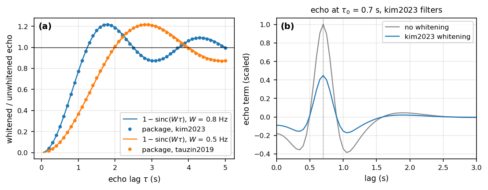
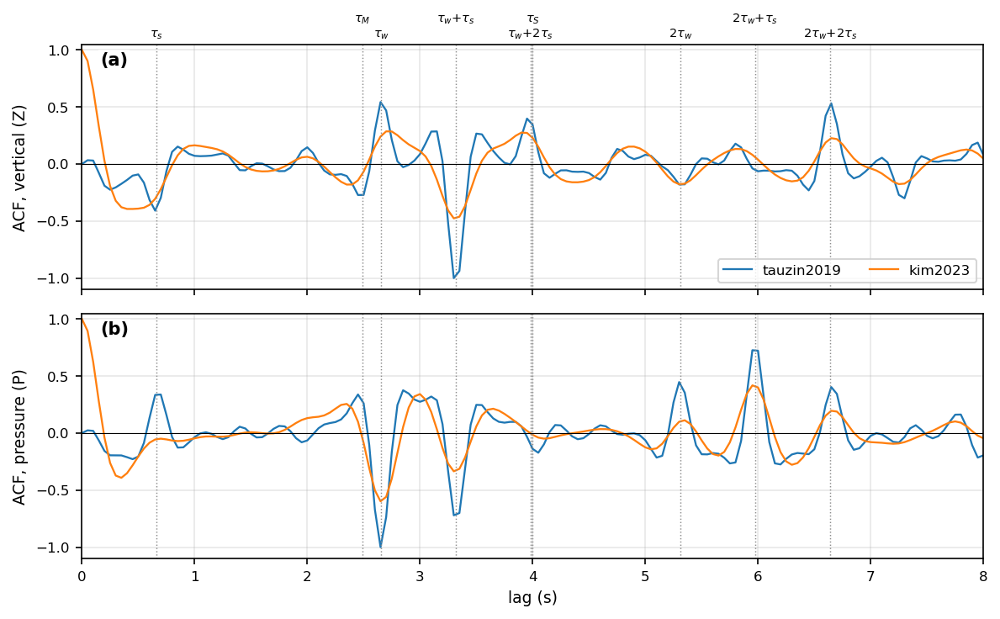

# Teleseismic P-wave Autocorrelation

A teleseismic P wave that reaches an ocean-bottom station is followed by its
reverberations in the sediment and in the water column. The autocorrelation
(ACF) of the P coda turns each reverberation into a peak at its two-way
time. `complybay.forward.acf` predicts that ACF for a 1-D layered model in
two steps, both in the frequency domain:

1. Compute the seafloor transfer function $H(f)$ of vertical motion (Z),
   pressure (P) and radial motion for a plane P wave of horizontal slowness
   $p$ (`ray_p`, s/km) coming up from the half-space
   (`forward.response.seafloor_response`, §2-3).
2. Pass $\lvert H\rvert$ through the same `ACFProcessing` as the recorded
   traces: optional noise level, running-mean whitening, zero-phase filters,
   inverse FFT, zero-lag taper, normalization (`complybay.acf`, §4).

## 1. Why the ACF of the transfer function

A recorded P coda is the source wavelet convolved with the impulse response
of the structure, $X(f) = S(f)\,H(f)$, so its ACF has the power spectrum
$\lvert S\rvert^2\lvert H\rvert^2$. Whitening divides by a running mean over
$W$ Hz; this removes the smooth $\lvert S\rvert^2$ of a short source but keeps
the ripple that reverberations put on $\lvert H\rvert^2$. An echo of
relative amplitude $\varepsilon$ and delay $\tau_0$ adds
$\varepsilon e^{2\pi i f\tau_0}$ to $H$, hence $2\varepsilon\cos(2\pi f\tau_0)$
to $\lvert H\rvert^2$, which the inverse FFT turns into a peak at lag
$\tau_0$ (the 1-D basis is Claerbout 1968). The synthetic therefore takes
$S = 1$. Only $\lvert H\rvert$ enters: the ACF carries no absolute time, and
the sign of a component does not matter. Source structure finer than $W$ is
not flattened and stays in observed ACFs; the synthetic does not model it.

## 2. Conventions

Time dependence $e^{-i\omega t}$; $z$ positive down, $z = 0$ at the seafloor.
Each solid layer is described by the motion-stress vector, with tractions
scaled so that the layer matrices of an elastic layer do not depend on
frequency:

--8<-- "docs/generated/acf_outputs.md"

$Z$ is vertical ground velocity, positive up; $R$ radial velocity, positive
in the direction of horizontal propagation; $P$ the pressure just above the
seafloor, positive in compression (`SeafloorResponse.component`). The
incident P wave has unit displacement amplitude at the top of the half-space
and moves the ground up; time zero is its arrival there.

## 3. The seafloor response

The water is a fluid without attenuation (`WaterLayer`: $v_{p,w}$ = 1.5
km/s, $\rho_w$ = 1.03 g/cm³ by default). Below it, $\tau_{xz}(0) = 0$, so the
seafloor state has three unknowns $\mathbf x = (u_x, u_z, \tau_{zz})$; $u_x$
is free because the fluid may slip. They are carried through every solid
layer to the half-space and split into its four plane waves (Appendix).
Three conditions fix $\mathbf x$ at each frequency:

| condition | where |
|---|---|
| up-going P has unit amplitude | top of the half-space |
| no up-going S | top of the half-space |
| pressure-free sea surface: $(u_z, \tau_{zz})$ continuous at the seafloor, carried up through the water, $\tau_{zz} = 0$ at $z = -H$ | water; without water $\tau_{zz}(0) = 0$ (land station) |

In the water the pressure satisfies a Helmholtz equation, so the last
condition reads

--8<-- "docs/generated/acf_sea_surface.md"

with $u_z(0)$ positive down. `docs/scripts/acf_derivation.py` checks the
package output against this independent form (largest residual $2\times
10^{-16}$ relative, with and without attenuation, $p$ = 0-0.06 s/km).
Attenuating layers use the complex velocities of
[Attenuation](attenuation.md), so their layer matrices are built per
frequency; vertical slownesses take the principal root, so down-going waves
decay with depth. The zero-frequency sample uses the reference velocities;
all outputs vanish there (each carries a factor $\omega$).

## 4. The processing chain

`synthetic_acfs(model, ray_p, processing, components, dt=0.05, duration=200)`
computes one response on the FFT grid ($L$ = `next_fast_len(duration / dt)`
samples) and processes each component. The steps that shape the ACF live in
`ACFProcessing` and run identically on data (`acf_from_trace`) and
synthetics (`acf_from_spectrum`):

| step | data | synthetic |
|---|---|---|
| cut the P-coda window | user | - |
| demean, detrend, Tukey taper (`taper_fraction`, default 0.05), zero-pad to $\ge 2\times$ length | yes | - |
| drop frequencies above the band limit (§8) | yes | yes |
| flat noise level `snr` (§7) | - | optional |
| whitening (`Whitening`) | yes | yes |
| zero-phase filters, multiplied in order into the power spectrum | yes | yes |
| inverse FFT, lags $0 \ldots$ `max_lag` | yes | yes |
| zero-lag taper $\sin^2(\pi\tau/2T)$ for $\tau < T$ = `zero_lag_taper` | yes | yes |
| normalize: `max`, `zero_lag` (before the taper) or `none` | yes | yes |
| stack (`stack_acfs`: linear or phase-weighted) | yes | - |

Whitening, with a floor at `water_level` $\ell$ times the largest running
mean inside the band:

--8<-- "docs/generated/acf_whitening.md"

Butterworth filters (`Bandpass`, `Highpass`, `Lowpass`, order $n$ =
`corners`) multiply the power spectrum by $\lvert B\rvert^4$, with
$\lvert B\rvert^2 = [1 + (f_c/f)^{2n}]^{-1}$ (high-pass) the Butterworth power
response, so 0.25 at the corner: the same as filtering the trace forward and
backward before autocorrelating. `GaussianFilter(a)` multiplies it by
$e^{-(\omega/2a)^2}$, i.e. filters the ACF once.

## 5. What whitening does to short lags

Dividing by a running mean also removes part of the structure's own ripple.
For the echo of §1, the mean of $\cos(2\pi f\tau_0)$ over a window of $W$ Hz
is $\operatorname{sinc}(W\tau_0)\cos(2\pi f\tau_0)$, so to first order in
$\varepsilon$ the whitened ripple is $2\varepsilon\,[1 -
\operatorname{sinc}(W\tau_0)]\cos(2\pi f\tau_0)$ (derived here, for both
averages; amplitude averaging gives the same first-order term):

--8<-- "docs/generated/acf_sinc.md"

Lags below about $1/W$ are damped before any filter acts: with `kim2023`
($W$ = 0.8 Hz) an echo at 0.3 s keeps 9 %, at 0.7 s 44 %; the sinc side
lobes amplify lags near $1.4/W$ by up to 22 %. Shallow-sediment P
reverberations (well under 1 s) are thus weak in whitened ACFs. The same
factor shapes the correlation of ACF errors ([Likelihood](likelihood.md)).



*Fig. 1. (a) Echo term $\mathrm{ACF}(\varepsilon) - \mathrm{ACF}(0)$ at lag
$\tau_0$, whitened over unwhitened, for $H = 1 + 0.01\,e^{2\pi i f\tau_0}$
with the whitening and filters of each preset: package (dots),
$1 - \operatorname{sinc}(W\tau)$ (lines), exact mean over the $2N + 1$
samples (dashed). The package agrees with $1 - \operatorname{sinc}$ within
0.015 and with the dashed form within 0.005 (asserted). (b) The echo term of a 0.7 s echo with the `kim2023` filters, without and
with whitening. Script: `docs/scripts/acf_whitening.py`.*

## 6. Reading an ACF

Peaks sit at two-way vertical times of single reverberations and their
combinations:

--8<-- "docs/generated/acf_lags.md"

The water multiples $m\tau_w$ (`water_multiple_lags(water, ray_p, n)`) and
their sums with the sediment time are the strongest peaks (Fig. 2). The
water multiple has opposite polarity on Z and P: the pressure-free sea
surface reflects pressure with $-1$ and vertical motion with $+1$. In this
model the sediment P reverberation is negative on Z (as on land) and positive
on P. The sediment S time $\tau_S$ gives no separate peak
here, and the crustal P time $\tau_M$ lies 0.17 s before $\tau_w$. The
sediment shows up mostly as the $\tau_s$ it adds to each water multiple. What
the ACF constrains in an inversion is on [Resolution](resolution.md).



*Fig. 2. Vertical (a) and pressure (b) ACFs of the docs model (2 km of
water; 0.6 km of sediment with $v_p$ = 1.8, $v_s$ = 0.3 km/s; crust and
mantle; values assumed, `docs/scripts/_models.py`) at $p$ = 0.06 s/km with
both presets (noise-free). Dotted lines: predicted lags. The script checks
that the largest peak after 1 s lies within 0.1 s of $\tau_w$ or
$\tau_w + \tau_s$ on every trace, that the water multiple has opposite signs
on Z and P, and the sediment peak signs. Script:
`docs/scripts/acf_reading.py`.*

## 7. Presets and the noise level

`preset(name)` returns an `ACFProcessing` from `acf.PRESETS`:

| | `tauzin2019` | `kim2023` |
|---|---|---|
| whitening | amplitude average, $W$ = 0.5 Hz, $\ell$ = 0.01 | power average, $W$ = 0.8 Hz, $\ell$ = 0 |
| filters | Butterworth band-pass 0.5-4 Hz, order 2 | Gaussian $a$ = 5, then high-pass 0.5 Hz, order 2 |
| zero-lag taper | 0.5 s | none |
| normalization | `max` | `zero_lag` |
| source | flow of Tauzin et al. (2019); numbers are unverified starting values | Kim et al. (2023), Supporting Text S2, as transcribed in `acf/processing.py`; high-pass order assumed |

The `kim2023` filters pass 0.55-1.72 Hz at half power. Normalizing at
$\tau = 0$ keeps amplitudes comparable between events; normalizing to the
maximum after a taper makes them depend on the taper. Neither preset was
re-checked against its paper for this page. Kim et al. cut 70 s from 10 s
before P, Tukey fraction 0.2 (`acf_from_trace(..., taper_fraction=0.2)`).

`snr` (observed RMS signal-to-noise ratio) adds a flat noise amplitude
before whitening, after Kim et al. (2023, Supporting Text S4):

--8<-- "docs/generated/acf_noise.md"

Taking the sum over the processed band of a unit-impulse synthetic is an
assumption (the paper leaves both open). A flat level shrinks the ripple of
$\lvert S\rvert$ relative to its running mean, so after whitening every peak
away from the zero lag is lower. How well this reproduces the amplitude of
noisy observed stacks is open; no script in the repository tests it
(`tools/make_synthetic_example.py --event-noise` makes noisy synthetic event
stacks for such a test).

## 8. Accuracy controls

**Band limit.** Frequencies above the last one where the product of the
filter power responses reaches `band_tolerance` (default $10^{-6}$, assumed)
times its peak, plus $W/2$, are set to zero for data and synthetics alike;
the response is not computed there. On the default grid:

--8<-- "docs/generated/acf_band.md"

**Duration.** The elastic response rings, most in deep water over a hard
seafloor, and whatever arrives after `duration` wraps onto early lags.
`wraparound_fraction(model, ray_p, processing, duration=...)` returns the
energy fraction of the filtered (not whitened) response in the last 10 % of
the window:

--8<-- "docs/generated/acf_wraparound.md"

It also counts the acausal half of the zero-phase-filtered first arrival,
which wraps to the end. When that arrival is within about 1 s of $t = 0$ (a
shallow half-space top) this sets a floor whatever the duration: about 0.5
for a half-space at the seafloor, about $5\times10^{-4}$ for the 6 km crust
above with `kim2023` (`acf_derivation.py`). The docstring suggests keeping
the fraction below about $10^{-4}$ (assumed).

## 9. When it fails

| condition | result |
|---|---|
| `ray_p` < 0; `component="pressure"` without water; `snr` $\le$ 1 | `ValueError` |
| `duration` $\le$ 2 `max_lag`, or `max_lag` $\ge$ half the FFT length | `ValueError` |
| `ray_p` $\ge 1/v_p$ of the half-space | no check; the incident P is evanescent, the result is meaningless |
| strong reverberations ($\varepsilon$ not small) | the factor of §5 holds only to first order |
| window too short for the model (§8) | late energy aliased onto early lags |

The method is linear and 1-D: a plane wave, flat interfaces, laterally
uniform layers, a source spectrum smooth over $W$.

## 10. Usage

```python
from complybay.acf import acf_from_trace, preset
from complybay.forward import synthetic_acfs, water_multiple_lags, wraparound_fraction
from complybay.model import LayeredModel, OBSModel, WaterLayer

solid = LayeredModel(thickness=[0.6, 6.0], vp=[1.8, 6.0, 8.1], vs=[0.3, 3.5, 4.5],
                     rho=[1.8, 2.8, 3.35])
model = OBSModel(solid, WaterLayer(2.0))
kim = preset("kim2023")
lags, acfs = synthetic_acfs(model, 0.06, kim)           # Z and P from one response
water_multiple_lags(model.water, 0.06, n=3)             # s
wraparound_fraction(model, 0.06, kim)                   # check before shortening duration
lags, acf = acf_from_trace(trace, 0.05, kim, taper_fraction=0.2)  # trace: one P-coda window
```

Keys of `obs.yaml` for an ACF observation in `complybay invert` (runnable
example: `examples/synthetic/`; the noise scale `noise` and
`error_correlation` are on [Likelihood](likelihood.md)):

```yaml
Station:
  water: {depth_km: 2.0}            # vp 1.5, rho 1.03 by default
Observations:
  acf:
    processing: kim2023             # default; or {preset: kim2023, <overrides>} or full settings
    ray_p: 0.06                     # s/km, required
    window: [0.3, 8.0]              # s, lags that enter the likelihood; required
    snr: null                       # default: noise-free synthetics
    components:
      vertical: {file: acf_z.dat}   # columns: lag (s) from 0, ACF, sigma; dt and max_lag from the file
      pressure: {file: acf_p.dat}
Forward:
  acf: {duration: 200.0}            # default 200 s
```

## Verified / not verified

Tests are in `tests/test_acf.py`.

| claim | checked by |
|---|---|
| land half-space doubles vertical motion at normal incidence | `test_land_halfspace_doubles_vertical_motion` |
| energy flux conserved, with and without water, $p$ = 0-0.07 ($10^{-10}$) | `test_energy_flux_is_conserved` |
| equals an independent normal-incidence acoustic propagator, elastic and attenuating ($10^{-9}$); $Q \to \infty$ limit | `test_normal_incidence_matches_acoustic_chain`, `test_attenuating_normal_incidence_matches_acoustic_chain`, `test_elastic_limit_of_attenuating_layers` |
| pressure-free sea surface at oblique incidence; layer eigenvectors from Hooke's law | `acf_derivation.py` only |
| sediment reverberation at $2hq_\alpha$ with negative sign (land); water multiple at $2Hq_w$, opposite sign on Z and P | `test_sediment_reverberation_time`, `test_water_reverberation_has_opposite_sign_on_pressure`, `acf_reading.py` |
| trace and spectrum paths give the same ACF (0.03) | `test_trace_and_spectrum_paths_agree` |
| whitening is a $2N+1$-sample running mean; water level | `test_whitening_uses_2n_plus_1_point_running_mean`, `acf_derivation.py` |
| whitening factor $1 - \operatorname{sinc}(W\tau)$ on a single echo (0.015) | `acf_whitening.py` only; its use for error correlations: `tests/test_acf_errors.py::test_processing_correlation_matches_simulated_noise` |
| filters chain as a product; band limit changes the ACF by < $10^{-5}$ | `test_filters_chain_multiplies_responses`, `test_band_limit_changes_acf_negligibly` |
| preset values as written in the code; `kim2023` half-power band | `test_kim2023_follows_supporting_text_s2`, `test_kim2023_preset` |
| `snr` noise level (Parseval); lowers ACF amplitude monotonically | `acf_derivation.py`; `test_snr_noise_lowers_acf_amplitude` |
| wraparound fraction falls with duration | `test_wraparound_fraction_shrinks_with_duration`, `acf_derivation.py` |

All checks use synthetic models. Not checked: real data; the preset values
against the papers; whether `snr` reproduces noisy stacks; comparison with
another ACF code (rein-acfcompute is GPL-3.0 and may only be run locally as a
reference); lateral heterogeneity and dipping interfaces.

## Appendix: the layer propagator

In a homogeneous layer $\mathbf v$ is a sum of four plane waves (down P, down
S, up P, up S). With $E$ the matrix of their motion-stress vectors (unit
displacement), a layer of thickness $h$ carries $\mathbf v$ from its top to
its bottom:

--8<-- "docs/generated/acf_propagator.md"

The three seafloor basis vectors ($\mathbf x$ placed in $\mathbf v$ with
$\tau_{xz} = 0$ by the $4\times3$ matrix $B$) are carried through all
layers and projected on the half-space waves, $\mathbf a = E_\mathrm{hs}^{-1} P_N\cdots P_1 B\,\mathbf x$.
The rows of $\mathbf a$ for up-going P and S give the first two conditions
of §3. In the water one P-wave pair with $q_w$ carries $(u_z, \tau_{zz})$ to
the sea surface, which gives the third. The frequency axis is folded into
the matrix products (one $4\times4$ by $4\times 3n_f$ product per elastic
layer). The down-going half-space amplitudes are kept as `reflected_p`,
`reflected_s` for the energy check.

??? example "Check script: `docs/scripts/acf_derivation.py`"

    ```python
    --8<-- "docs/scripts/acf_derivation.py"
    ```

## References

- Claerbout, J. F. (1968). Synthesis of a layered medium from its acoustic
  transmission response. *Geophysics*, 33(2), 264-269.
  [doi:10.1190/1.1439927](https://doi.org/10.1190/1.1439927)
- Kim, H., Kawakatsu, H., Akuhara, T., & Takeuchi, N. (2023). Characterizing
  the seafloor sediment layer using teleseismic body waves recorded by ocean
  bottom seismometers. *Journal of Geophysical Research: Solid Earth*,
  128(12), e2023JB027616.
  [doi:10.1029/2023JB027616](https://doi.org/10.1029/2023JB027616)
- Tauzin, B., Pham, T.-S., & Tkalčić, H. (2019). Receiver functions from
  seismic interferometry: a practical guide. *Geophysical Journal
  International*, 217(1), 1-24.
  [doi:10.1093/gji/ggz002](https://doi.org/10.1093/gji/ggz002)
