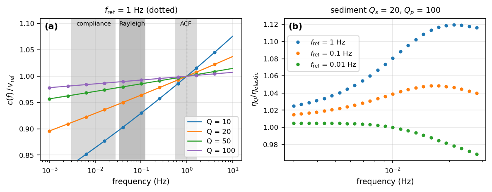

# Constant-Q Attenuation

Sediments attenuate seismic waves, and attenuation implies velocity
dispersion: the same layer is slower at compliance frequencies (mHz) than at
ACF frequencies (Hz). `complybay.forward.attenuation` implements the
constant-Q model of Kjartansson (1979). These steps are the whole method:

1. Give a `LayeredModel` quality factors `qp`, `qs` per layer (`inf` =
   elastic) and a reference frequency `q_reference_frequency` (default 1 Hz,
   assumed). Its `vp`, `vs` are then **phase velocities at that frequency**.
2. Each solver evaluates the layers at its own frequencies: the ACF response
   with complex velocities, compliance and phase velocity with real phase
   velocities (§3).

The water column has no attenuation. Without finite Q every solver runs its
elastic code unchanged.

## 1. The complex velocity

A modulus $M(\omega) = M_0(-i\omega/\omega_0)^{2\gamma}$ has a quality factor
that does not depend on frequency (Kjartansson 1979). For time dependence
$e^{-i\omega t}$ the complex velocity $\sqrt{M/\rho}$, scaled so that the
phase velocity at $f_\mathrm{ref}$ is $v_\mathrm{ref}$, is
(`complex_velocity(v_ref, q, freqs, f_ref)`)

--8<-- "docs/generated/attenuation_velocity.md"

and with $k = \omega/\tilde v$ (Appendix)

--8<-- "docs/generated/attenuation_identities.md"

so a plane wave $e^{i(kx - \omega t)}$ decays with distance and a layer is
faster at higher frequency. $Q = \infty$ gives $\gamma = 0$ and
$\tilde v = v_\mathrm{ref}$. Density does not change.

## 2. The size of the dispersion

To first order $c(f)/v_\mathrm{ref} \approx 1 + \ln(f/f_\mathrm{ref})/(\pi Q)$.
Percent change of $c$ relative to $v_\mathrm{ref}$, exact power law (first
order in brackets):

--8<-- "docs/generated/attenuation_first_order.md"

For $Q_s = 20$ the shear velocity at 0.01 Hz is 7 % below that at 1 Hz. The
first-order form is within 0.3 % of the power law for $Q \ge 20$ over two
decades of frequency.

## 3. How Q enters each solver

| solver | what it uses | neglected |
|---|---|---|
| ACF response ([ACF](acf.md)) | complex $\tilde v(f)$ in every attenuating layer (layer matrices built per frequency); $f = 0$ uses $v_\mathrm{ref}$ | - |
| compliance ([Compliance](compliance.md)) | elastic model with $c(f)$ at each frequency (`dispersed(solid, f)`) | imaginary moduli: change $\lvert\eta\rvert$ at $O(1/Q^2)$ |
| phase velocity ([Dispersion](dispersion.md)) | elastic model with $c(1/T)$, one disba call per period; kernels the same | attenuation of the surface wave |

`dispersed(solid, freq)` returns an elastic copy with each layer's phase
velocity at `freq`; at $f = f_\mathrm{ref}$ it is the elastic model itself.
Using real velocities for compliance and surface waves is the first-order
physical-dispersion correction (Kanamori & Anderson 1977).

## 4. What the reference frequency means

The velocities of an attenuating model hold at $f_\mathrm{ref}$; each data
type sees them shifted by the power law at its own band (Fig. 1a). The
farther a band lies from $f_\mathrm{ref}$, the more Q changes the data: with
$f_\mathrm{ref}$ = 1 Hz compliance sees a softer sediment, with
$f_\mathrm{ref}$ = 0.01 Hz the ACF sees a stiffer one (Fig. 1b, table). An
elastic model fitted to all three data types takes velocities that
compromise between their bands; with Q in the model, $f_\mathrm{ref}$ states
where its velocities hold. Velocities from logs, refraction or geotechnical
relations hold near their own frequency, which then is the natural
$f_\mathrm{ref}$.



*Fig. 1. (a) $c(f)/v_\mathrm{ref}$ for $f_\mathrm{ref}$ = 1 Hz (dotted) and
four Q: `phase_velocity_at` (lines) and $\omega/\operatorname{Re}k$ from
`complex_velocity` (dots); shaded: compliance band (3 mHz to $f_c$ of 2 km of
water), Rayleigh 8-30 s, `kim2023` ACF half-power band. (b) Compliance of
the docs model (sediment $Q_s$ = 20, $Q_p$ = 100; values assumed,
`docs/scripts/_models.py`) over the elastic one for three $f_\mathrm{ref}$;
at $f = f_\mathrm{ref}$ the two agree to $10^{-12}$ (asserted). Script:
`docs/scripts/attenuation_bands.py`.*

What sediment Q changes in the data of `examples/synthetic` (2 km of water,
sediment 0.6 km with $v_s$ 0.15-0.6 km/s and $v_p$ 1.75 km/s, Q in the
sediment only), against the elastic model: mean $(\Delta/\sigma)^2$ per
datum and largest $\lvert\Delta\rvert/\sigma$ (brackets), with the example's
$\sigma$ (compliance 10 %, phase velocity 0.02 km/s, ACF 0.05 per lag over
0.3-8 s, `kim2023`):

--8<-- "docs/generated/attenuation_effect.md"

Compliance responds to $Q_s$ when $f_\mathrm{ref}$ is far above its band.
The ACF barely sees $Q_s$ and sees $Q_p$ when it is a few tens or when
$f_\mathrm{ref}$ lies far below 1 Hz. Phase velocity at 8-30 s changes by
less than $0.3\sigma$ in every case. Script:
`docs/scripts/attenuation_effect.py` (forward calculations only).

## 5. Limits

| condition | result |
|---|---|
| $Q \le 0$, a frequency $\le 0$ in `complex_velocity` or `phase_velocity_at` | `ValueError` |
| `qp`/`qs` with the wrong length or NaN | `ValueError` at `LayeredModel` construction |

Q is constant with frequency by construction; a frequency-dependent Q
would need another model. Water and density are not dispersed.

## 6. Usage

```python
import numpy as np
from complybay.forward import compliance
from complybay.forward.attenuation import dispersed
from complybay.model import LayeredModel, OBSModel, WaterLayer

solid = LayeredModel(thickness=[0.6, 6.0], vp=[1.8, 6.0, 8.1], vs=[0.3, 3.5, 4.5],
                     rho=[1.8, 2.8, 3.35], qp=[100, np.inf, np.inf], qs=[20, np.inf, np.inf],
                     q_reference_frequency=1.0)   # vp, vs hold at 1 Hz
model = OBSModel(solid, WaterLayer(2.0))
eta = compliance(model, [0.005, 0.01])            # sediment slower here than at 1 Hz
low = dispersed(solid, 0.01)                      # elastic copy at 0.01 Hz
```

In `model.yaml` a segment becomes attenuating with a `qs` and/or `qp`
profile, fixed or sampled; the reference frequency is a model key (details
on [Parameterization](parameterization.md)):

```yaml
Model:
  q_reference_frequency_hz: 1.0     # default 1 Hz
  segments:
    - name: sediment
      qs: {type: constant, value: 20.0}                # or {parameter: sed.qs}
      qp: {type: constant, value: 100.0}
```

## Verified / not verified

Tests are in `tests/test_attenuation.py` unless named otherwise.

| claim | checked by |
|---|---|
| $Q = \operatorname{Re}M/(-\operatorname{Im}M)$; phase velocity power law; decay $\omega/(2Qc)$ to $O(1/Q^2)$ | `test_constant_q_identities`, `attenuation_derivation.py` |
| elastic limit $Q = \infty$; input validation | `test_elastic_limit_and_validation` |
| `dispersed` gives the first-order shift (7 % for $Q_s$ = 20, 0.01 Hz) and is unchanged at $f_\mathrm{ref}$ | `test_dispersed_model` |
| ACF response with complex velocities equals an independent acoustic propagator ($10^{-9}$); $Q = 10^{12}$ gives the elastic response | `tests/test_acf.py::test_attenuating_normal_incidence_matches_acoustic_chain`, `::test_elastic_limit_of_attenuating_layers` |
| attenuating half-space compliance follows the static limit at the dispersed velocities | `tests/test_compliance.py::test_attenuating_halfspace_uses_the_velocities_at_each_frequency` |
| $\lvert\eta\rvert$ changes at $O(1/Q^2)$ | `compliance_derivation.py` only, static half-space |
| Rayleigh speed of a half-space with $Q_p = Q_s$ scales by $(f/f_\mathrm{ref})^\gamma$ ($10^{-6}$) | `tests/test_dispersion.py::test_attenuating_halfspace_rayleigh_speed_follows_the_dispersion` |
| effect table, Fig. 1 | `attenuation_effect.py`, `attenuation_bands.py` only |

All checks use synthetic models. Not checked: causality of the model
(Kjartansson's result, taken as given); whether the data can constrain Q
themselves; real sediments, where Q may depend on frequency.

## Appendix: derivation

With $M \propto (-i\omega)^{2\gamma} = \omega^{2\gamma}e^{-i\pi\gamma}$,
$\tilde v \propto \omega^\gamma e^{-i\pi\gamma/2}$ and
$k = \omega/\tilde v \propto \omega^{1-\gamma}e^{i\pi\gamma/2}$. Then
$\operatorname{Re}M/(-\operatorname{Im}M) = \cos\pi\gamma/\sin\pi\gamma$,
which defines $\gamma = \arctan(1/Q)/\pi$; $\omega/\operatorname{Re}k \propto
\omega^\gamma/\cos(\pi\gamma/2)$, and fixing it to $v_\mathrm{ref}$ at
$f_\mathrm{ref}$ gives the factor $\cos(\pi\gamma/2)$ of §1;
$\operatorname{Im}k/\operatorname{Re}k = \tan(\pi\gamma/2) \approx 1/(2Q)$.
`docs/scripts/attenuation_derivation.py` asserts each identity against the
package (round-off, $10^{-12}$; decay within $1.5/Q^2$).

## References

- Kanamori, H., & Anderson, D. L. (1977). Importance of physical dispersion
  in surface wave and free oscillation problems: review. *Reviews of
  Geophysics*, 15(1), 105-112.
  [doi:10.1029/RG015i001p00105](https://doi.org/10.1029/RG015i001p00105)
- Kjartansson, E. (1979). Constant Q-wave propagation and attenuation.
  *Journal of Geophysical Research: Solid Earth*, 84(B9), 4737-4748.
  [doi:10.1029/JB084iB09p04737](https://doi.org/10.1029/JB084iB09p04737)
