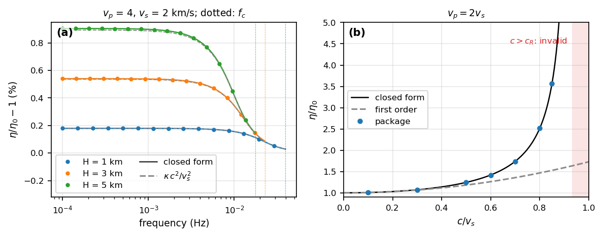
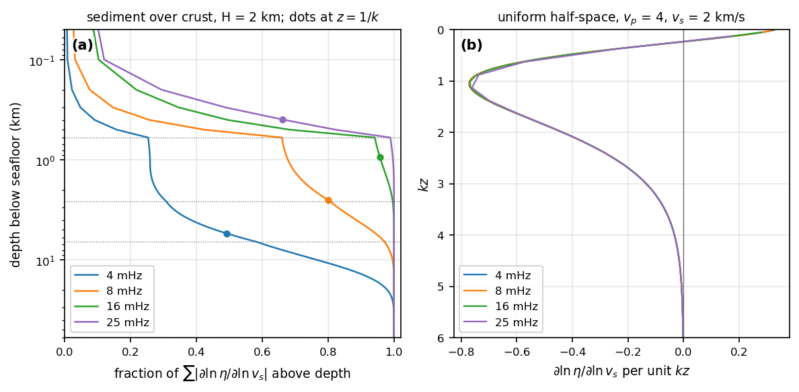

# Seafloor Compliance

Long-period ocean surface gravity waves (infragravity waves) press on the
seafloor, which moves down by an amount that depends on the shear velocity
below it, to depths of order one wavelength. Compliance is that displacement
divided by the pressure. `complybay.forward.compliance` computes it for a
1-D layered model. These steps are the whole method:

1. For each frequency $f$, find the wavenumber $k$ of a gravity wave in water
   of depth $H$ (§2).
2. Cut the solid model at depth $D/k$ ($D$ = `decay_cutoff`); the first
   layer below the cut becomes the half-space (§4).
3. Solve the elastic response of the layered solid to a seafloor pressure
   $p\,e^{i(kx - \omega t)}$, i.e. at horizontal slowness $k/\omega$ (§3).
4. Return $\eta = k\,u_z / p$ (§1).

## 1. What is computed

The normalized compliance (Crawford et al. 1991)

$$
\boxed{\;\eta(\omega) = \frac{k\, u_z(0)}{p(0)}\;}
\qquad [1/\mathrm{Pa}],
$$

with $u_z$ the vertical seafloor displacement (positive down), $p$ the
pressure on it (positive in compression) and $k$ in 1/m. $\eta > 0$, and the
factor $k$ makes $\eta$ of a uniform half-space frequency-independent in the
static limit (§5). The water enters only through $k$, i.e. its depth; its
velocity and density are not used. Inputs are in package units (Hz, km,
km/s, g/cm³) and are converted to SI for the Fortran propagator;
$g = 9.79329$ m/s² (`G_DEFAULT`, the value of Crawford's code).

## 2. The wavenumber and the infragravity cutoff

Linear potential flow in water of constant depth $H$ gives (Appendix)

--8<-- "docs/generated/compliance_dispersion.md"

| `wavenumber` | method | error |
|---|---|---|
| `"exact"` (default) | Newton iteration, relative step $< 10^{-14}$ | round-off |
| `"poly"` | series approximation of MDN-Compliance (`gravd`); deep-water $k = \omega^2/g$ once $\omega^2 H / g > 2.96$ | table below |

Error of `"poly"`, frequencies $10^{-4}$ Hz to $f_c$:

--8<-- "docs/generated/compliance_poly.md"

The $k$ error depends on $kH$ only; the compliance error depends on the
model and is largest where the load starts to sense a soft layer. The
pressure reaching the seafloor falls off as $1/\cosh kH$, exponentially once
the wavelength is shorter than the depth. `infragravity_cutoff(depth_m)` (m
in, Hz out) is the frequency at which the wavelength equals the depth:

--8<-- "docs/generated/compliance_cutoff.md"

$f_c$ = 0.028 Hz in 2 km of water. Measured compliance above $f_c$ is
dominated by noise; $\lambda = H$ is a convention (assumed), not a sharp
limit. `complybay invert` warns at setup when data lie above $f_c$.

## 3. The layered-solid response

The response comes from `raydep_ft`, a Fortran translation (S. Mosher) of
W. Crawford's MATLAB code. It solves the P-SV equations for homogeneous
elastic layers over a half-space at horizontal slowness $k/\omega$, from rows
(thickness in m, density, $v_p$, $v_s$), keeping only waves that decay with
depth in the half-space. At the seafloor the shear traction is zero, and
$\eta = -k\,v/(\omega\,zz)$ is formed from the vertical motion `v` and normal
stress `zz` there. The internals are Crawford's and are not re-derived here;
the output is checked against the closed form of §5 and an independent
Python port of the same code (Verified, below).

## 4. Where the model is cut

In a uniform half-space the load decays as $e^{-q k z}$, with
$q = \sqrt{1 - c^2/v^2} \approx 1$ for P and S since $c \ll v$ in most rocks
(Appendix). The propagator multiplies growing exponentials, which overflow
on deep models at high frequency, so for each frequency the layers whose tops
lie above $z_\mathrm{cut} = D/k$ are kept and the next layer becomes the
half-space. The default $D = 25$ (assumed) cuts where the load has decayed by
$e^{-25} \approx 10^{-11}$; at $f_c$, $z_\mathrm{cut} \approx 4H$. On a
150 km model under 2 km of water, $D = 40$ changes $\eta$ at 3 and 10 mHz by
less than $10^{-9}$, and a copy ending at 28 km gives the same $\eta$ to
$10^{-10}$ at 25 and 30 mHz, where the cut lies above 28 km. The layer that
serves as the half-space must satisfy the conditions of §7 at every
frequency.

## 5. The static limit and the dynamic correction

For a uniform half-space $\eta$ has a closed form (derived here; the
moving-load problem of Cole & Huth 1958):

--8<-- "docs/generated/compliance_halfspace.md"

As $c \to 0$ it becomes the static compliance
(`complybay.forward.compliance.halfspace_compliance(vp, vs, rho)`):

--8<-- "docs/generated/compliance_static.md"

and to first order in $(c/v_s)^2$

--8<-- "docs/generated/compliance_correction.md"

The dynamic term is largest at low frequency, where $c \to \sqrt{gH}$; for
$v_s \ge 2$ km/s and $H \le 5$ km it is about 1 % or less (Fig. 1a). For soft
material the full form is needed: at $c_R$ the denominator vanishes and
$\eta$ diverges (Fig. 1b).



*Fig. 1. (a) Half-space ($v_p$ = 4, $v_s$ = 2 km/s, $\rho$ = 2.5 g/cm³)
under 1, 3 and 5 km of water, relative to the static limit: package (dots),
closed form (lines), first-order term (dashed); dotted lines mark $f_c$.
(b) $\eta/\eta_0$ against $c/v_s$ for $v_p = 2v_s$: closed form, first-order
term, and package values for half-spaces soft enough to reach each $c/v_s$
(4 km water, 0.1 mHz). Shaded: $c > c_R$, not physical (§7). Script:
`docs/scripts/compliance_halfspace.py`.*

## 6. Sensitivity kernels

`compliance_kernel(model, freqs, parameter)` returns
$K_i = \partial \ln \eta / \partial \ln m_i$ for every layer and the
half-space (last column), $m$ one of `vp`, `vs`, `rho`, by central
differences with relative step `rel_step` (default 0.025) and the same
`wavenumber`, `g` and `decay_cutoff` as `compliance`. Layers dropped by the
cut get $K_i = 0$. $K_i$ depends on layer thickness, so compare layers on an
even grid (`LayeredModel.resampled`).

The load senses depths of order $1/k = \lambda/2\pi$. In a uniform half-space
the $v_s$ kernel per unit $kz$ is one curve for all frequencies (within 5 %
of its peak; the dynamic term and the layer sampling break exact scaling).
It is positive just below the seafloor, changes sign at $kz \approx 0.23$, is
most negative at $kz \approx 1.1$ and negligible beyond $kz \approx 5$
(Fig. 2b). In a layered model a soft sediment dominates at high frequency,
and lower frequencies reach into the crust (Fig. 2a).



*Fig. 2. (a) Sediment (0.6 km, $v_s$ = 0.3 km/s) over a two-layer crust and
mantle under 2 km of water, in 0.1 km layers: fraction of the summed
$|\partial\ln\eta/\partial\ln v_s|$ above each depth, 4-25 mHz ($f_c$ =
28 mHz); dots at $z = 1/k$, dotted lines at interfaces. (b) Uniform
half-space in 0.1 km layers: $v_s$ kernels ($v_p$, $\rho$ fixed) per unit
$kz$. Model values are assumed (`docs/scripts/_models.py`). The script also
checks that the density kernels sum to $-1$ (scaling every density scales
every modulus, so $\eta \propto 1/\rho$). Script:
`docs/scripts/compliance_kernel.py`.*

## 7. Attenuation and failure conditions

With finite `qp`, `qs`, each frequency uses the elastic model with the
constant-Q phase velocities at that frequency (Kjartansson 1979;
`forward.attenuation.dispersed`; see
[Attenuation](attenuation.md)).
The imaginary parts of the moduli are left out: they change $\lvert\eta\rvert$
only at order $1/Q^2$ (derived here, Appendix).

| condition | result |
|---|---|
| no water layer, or a frequency $\le 0$ | `ValueError` |
| $c \ge v_s$ of the half-space (after the cut) | NaN: no decaying S wave |
| $c_R < c < v_s$ of the half-space | finite but meaningless (past the Rayleigh resonance) |
| $c$ close to $c_R$ | $\eta$ very large: the load travels at the Rayleigh speed |

Since $c \le \sqrt{gH}$ (0.22 km/s at $H$ = 5 km) and $c_R \ge 0.87\,v_s$,
the last three need a half-space with $v_s$ below about 0.25 km/s for
$H \le 5$ km. The method is linear and 1-D: small waves, a flat seafloor and
laterally uniform structure within about one wavelength.

## 8. Usage

```python
from complybay.forward import compliance, compliance_kernel
from complybay.model import LayeredModel, OBSModel, WaterLayer

solid = LayeredModel(thickness=[0.6, 6.0], vp=[1.8, 6.0, 8.1], vs=[0.3, 3.5, 4.5],
                     rho=[1.8, 2.8, 3.35])
model = OBSModel(solid, WaterLayer(2.0))
freqs = [0.005, 0.01, 0.02]                      # Hz, below f_c = 0.028 Hz
eta = compliance(model, freqs)                   # 1/Pa
kernel = compliance_kernel(model, freqs, "vs")   # shape (3, 3)
```

Keys of `obs.yaml` for a compliance observation in `complybay invert`
(runnable example: `examples/synthetic/`; the noise scale `noise` is on
[Likelihood and posterior](likelihood.md)):

```yaml
Station:
  water: {depth_km: 2.0}          # required; only the depth enters compliance
Observations:
  compliance:
    file: compliance.dat          # columns: frequency (Hz), compliance (1/Pa), sigma
Forward:
  compliance: {wavenumber: exact} # default exact; or poly
```

## Verified / not verified

Tests are in `tests/test_compliance.py` unless named otherwise.

| claim | checked by |
|---|---|
| exact $k$ solves the dispersion relation ($10^{-12}$, 50 m-6 km); shallow- and deep-water limits | `test_exact_wavenumber_solves_dispersion_relation`, `test_wavenumber_limits` |
| both $k$ options and $\eta$ equal the v0.1 outputs | `test_wavenumbers_match_legacy`, `test_compliance_matches_legacy` |
| the Fortran propagator equals an independent Python port of Crawford's code ($10^{-6}$) | `tests/test_legacy_forward.py::test_python_reference_matches_baseline_and_fortran` |
| half-space $\eta$ within $2(c/v_s)^2$ of the static limit | `test_halfspace_approaches_static_solution` |
| half-space $\eta$ equals the closed form ($10^{-9}$); $\kappa$ is its small-$c$ slope | `docs/scripts/compliance_derivation.py` only |
| $f_c$ is where $kH = 2\pi$ | `test_infragravity_cutoff_is_where_the_wavelength_equals_the_depth`, `compliance_derivation.py` |
| truncation leaves $\eta$ unchanged and avoids overflow | `test_deep_model_is_truncated_instead_of_overflowing` |
| kernel is the central difference, uses `decay_cutoff`, does not modify the model | `test_kernel_is_central_difference_and_leaves_model_alone`, `test_kernel_passes_decay_cutoff_through` |
| density kernels sum to $-1$ ($2\times10^{-3}$); half-space kernels collapse in $kz$ (5 %); their sign change and minimum | `docs/scripts/compliance_kernel.py` only |
| attenuating half-space follows the static limit at the dispersed velocities | `test_attenuating_halfspace_uses_the_velocities_at_each_frequency` |
| $\lvert\eta\rvert$ changes at $O(1/Q^2)$ | `compliance_derivation.py`, static half-space only |
| `poly` error table | `compliance_derivation.py` only, model of Fig. 2 |
| NaN for $c > v_s$, sign change past $c_R$ | `compliance_halfspace.py` only |
| missing water raises | `test_compliance_requires_water` |

All checks use synthetic models. Not checked: real data; that data above
$f_c$ are noise; lateral heterogeneity and topography; the propagator
internals against Crawford's derivation; the source of the value of $g$.

## Appendix: derivations

**Gravity waves.** With $z$ up and the sea surface at $z = 0$, the potential
$\phi = \cosh k(z + H)\, e^{i(kx - \omega t)}$ satisfies Laplace's equation
and has no flow through the seafloor. The free-surface condition
$\partial_t^2 \phi + g\,\partial_z \phi = 0$ at $z = 0$ gives the dispersion
relation; the pressure $p = -\rho_w \partial_t \phi$ gives the ratio
$1/\cosh kH$; $k = 2\pi/H$ gives $f_c$.

**Half-space.** With $z$ down, the potentials $A\,e^{-k q_\alpha z}$ and
$B\,e^{-k q_\beta z}$ (times $e^{i(kx - \omega t)}$, $\omega = kc$) satisfy the
elastic equations of motion and decay with depth. The seafloor conditions
$\sigma_{zz} = -p$, $\sigma_{xz} = 0$ fix $A$ and $B$, and $\eta = k u_z/p$
follows; its series in $c^2/v_s^2$ gives $\eta_0$ and $\kappa$.

**Attenuation.** With $M = \lambda + 2\mu \to M(1 - i/Q_p)$ and
$\mu \to \mu(1 - i/Q_s)$, $\eta$, a real function of the moduli, becomes
$\eta\,(1 + i\epsilon) + O(1/Q^2)$ with $\epsilon$ real, so
$\lvert\eta\rvert$ changes only at $O(1/Q^2)$.

The script below asserts each closed form against the package with numpy.

??? example "Check script: `docs/scripts/compliance_derivation.py`"

    ```python
    --8<-- "docs/scripts/compliance_derivation.py"
    ```

## References

- Cole, J., & Huth, J. (1958). Stresses produced in a half plane by moving
  loads. *Journal of Applied Mechanics*, 25(4), 433-436.
  [doi:10.1115/1.4011853](https://doi.org/10.1115/1.4011853)
- Crawford, W. C., Webb, S. C., & Hildebrand, J. A. (1991). Seafloor
  compliance observed by long-period pressure and displacement measurements.
  *Journal of Geophysical Research: Solid Earth*, 96(B10), 16151-16160.
  [doi:10.1029/91JB01577](https://doi.org/10.1029/91JB01577)
- Kjartansson, E. (1979). Constant Q-wave propagation and attenuation.
  *Journal of Geophysical Research: Solid Earth*, 84(B9), 4737-4748.
  [doi:10.1029/JB084iB09p04737](https://doi.org/10.1029/JB084iB09p04737)
- MDN-Compliance (S. Mosher), source of the Fortran propagator and of the
  `poly` wavenumber: <https://github.com/s-g-mo/MDN-Compliance> (software).
