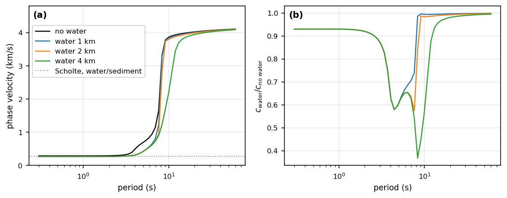
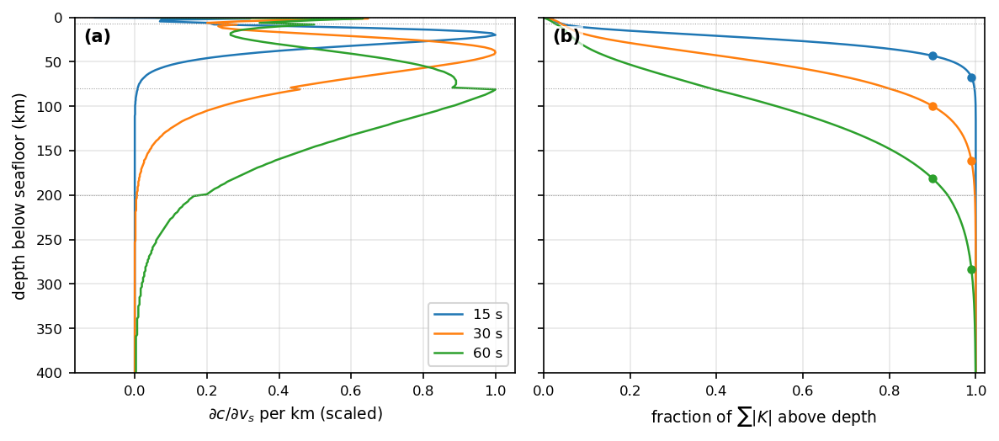

# Rayleigh Phase Velocity

`complybay.forward.dispersion` computes surface-wave phase velocity for a
seafloor model with disba (Luu), a Python port of the `surf96` routines of
Computer Programs in Seismology (Herrmann 2013). These steps are the whole
method:

1. Stack water (as a fluid, $v_s = 0$), the solid layers and the half-space
   into disba's arrays (`disba_arrays`; the half-space thickness is ignored).
2. Find the root of the Rayleigh (or Love) period equation for each period,
   by default with Dunkin's (1965) matrix (`algorithm="dunkin"`), searching
   in phase-velocity steps `dc` (default 0.005 km/s, assumed) and following
   the curve from the shortest period up.
3. Return $c(T)$ in km/s in the order of the input periods, NaN where the
   mode has no root.

## 1. Water as a fluid top layer: the Scholte limit

disba treats a top layer with $v_s = 0$ as a fluid, so the water enters with
its depth, $v_{p,w}$ and $\rho_w$. At periods short enough that the wave
neither reaches the sea surface nor leaves the top solid layer, mode 0 is
the Scholte wave of a fluid half-space over a solid half-space, whose speed
solves

--8<-- "docs/generated/dispersion_scholte.md"

--8<-- "docs/generated/dispersion_scholte_value.md"

The package reproduces the root under 30 km of water at 0.5 and 1 s within
$10^{-6}$ for a hard ($v_s$ = 3 km/s) and two soft seafloors
(`docs/scripts/dispersion_derivation.py`).

## 2. The steep rise at short periods

Below about 10 s the fundamental mode of a sedimented seafloor drops steeply
from crustal speeds to the Scholte speed of the sediment (Fig. 1a). Water
slows the mode at every period and moves the rise to longer periods: by
about 42 % near 4.4 s for 1-4 km of water, and by 63 % near 8.3 s under 4 km
(Fig. 1b; asserted in the script). The rise is the fundamental mode itself, not a jump of the root
search: one-period calls, a ten times finer `dc` and a curve started at a
longer period give the same values (within $10^{-5}$), and mode 1 lies
above it. Mode 0 below 10 s is thus controlled by water depth and the
shallowest sediment.



*Fig. 1. (a) Mode-0 phase velocity of the docs model (0.6 km of sediment
with $v_s$ = 0.3 km/s over crust and mantle; values assumed,
`docs/scripts/_models.py`) under 0, 1, 2 and 4 km of water; dotted: Scholte
speed of water over the sediment. (b) The water-loaded curves over the
curve without water. Script:
`docs/scripts/dispersion_water.py`.*

## 3. Kernels and the model bottom

`phase_velocity_kernel(model, period, parameter)` returns, for each solid
layer and the half-space (last entry; the water is dropped), disba's
one-sided difference with relative step 0.025:

--8<-- "docs/generated/dispersion_kernel_definition.md"

(units km/s per km/s for `vs`, `vp`; km/s per g/cm³ for `rho`; recomputed
with `phase_velocity` in `dispersion_derivation.py`). $K_i$ is about the
integral of the sensitivity over layer $i$, so compare layers per km, or on
an even grid (`LayeredModel.resampled`). The cumulative sum of
$\lvert K_i\rvert$ does not depend on the grid and tells where the model
bottom has to be:

--8<-- "docs/generated/dispersion_kernel_depths.md"

The half-space should start below the 99 % depth of the longest period
used; its single kernel entry otherwise lumps real structure. The numbers
depend on the model (assumed one below) and grow with period.



*Fig. 2. Assumed oceanic model under 4 km of water (0.4 km sediment, crust to
7 km, lid to 80 km, low-velocity zone to 200 km, half-space from 400 km), in
layers of at most 2 km. (a) $\partial c/\partial v_s$ per km, each period
scaled by its maximum; dotted lines at interfaces. (b) Fraction of
$\sum\lvert K\rvert$ above each depth; dots at 90 % and 99 %. The half-space
holds less than 0.1 % at every period (asserted). Script:
`docs/scripts/dispersion_kernel.py`.*

## 4. Attenuation

With finite `qp`, `qs` each period $T$ uses the elastic model with the
constant-Q phase velocities at $f = 1/T$ (`forward.attenuation.dispersed`;
[Attenuation](attenuation.md)), one disba call per period. This is the
first-order physical-dispersion correction (Kanamori & Anderson 1977); the
attenuation of the surface wave itself is not computed. Kernels of an
attenuating model use the same dispersed model.

## 5. When it fails

| condition | result |
|---|---|
| a period $\le 0$ | `ValueError` |
| no root for the requested mode at a period (e.g. a higher mode at long periods) | NaN at that period |
| the fundamental-mode search fails at any period | disba raises; `phase_velocity` returns NaN at every period of that call (attenuating models: only at that period) |
| two roots closer than `dc` | a root can be missed and the search lands on another branch; seen for mode 1 under 2 km of water below about 2.8 s (default and ten times finer `dc` disagree; which, if either, is right is not checked), not for mode 0 there |

The model is 1-D, isotropic and elastic apart from the dispersion of §4.

## 6. Usage

```python
from complybay.forward import phase_velocity, phase_velocity_kernel
from complybay.model import LayeredModel, OBSModel, WaterLayer

solid = LayeredModel(thickness=[0.6, 6.0, 53.0], vp=[1.8, 6.0, 8.1, 7.9],
                     vs=[0.3, 3.5, 4.55, 4.3], rho=[1.8, 2.8, 3.35, 3.35])
model = OBSModel(solid, WaterLayer(4.0))
c = phase_velocity(model, [8.0, 15.0, 30.0])        # km/s, mode-0 Rayleigh
k = phase_velocity_kernel(model.with_solid(solid.resampled(2.0)), 30.0, "vs")
```

Keys of `obs.yaml` for a dispersion observation in `complybay invert`
(runnable example: `examples/synthetic/`; the noise scale `noise` is on
[Likelihood](likelihood.md)):

```yaml
Station:
  water: {depth_km: 2.0}             # depth, vp 1.5 and rho 1.03 by default all enter
Observations:
  dispersion:
    file: vph.dat                    # columns: period (s), phase velocity (km/s), sigma
    wave: rayleigh                   # default
    mode: 0                          # default
Forward:
  dispersion: {algorithm: dunkin, dc: 0.005}   # defaults
```

## Verified / not verified

Tests are in `tests/test_dispersion.py`.

| claim | checked by |
|---|---|
| short-period mode 0 under deep water equals the Scholte speed ($10^{-5}$), hard and soft seafloor | `test_short_period_limit_is_scholte_wave`, `dispersion_derivation.py` |
| thin water converges to the dry result ($10^{-3}$) | `test_thin_water_converges_to_solid_only` |
| water slows short periods (> 30 % at 8 s under 4 km), not long ones (< 2 % at 30 s) | `test_water_slows_short_periods` |
| output follows the input order; NaN where a mode has no root | `test_output_follows_input_order_and_marks_missing_roots` |
| attenuating half-space with $Q_p = Q_s$ scales exactly by $(f/f_\mathrm{ref})^\gamma$ ($10^{-6}$) | `test_attenuating_halfspace_rayleigh_speed_follows_the_dispersion` |
| water is passed first; kernel drops it and peaks at 10-40 km at 20 s | `test_disba_arrays_put_water_first`, `test_kernel_drops_water_layer` |
| kernel is the one-sided difference with step 0.025 | `dispersion_derivation.py` only |
| the rise near 8 s is mode 0, not a search jump; mode 1 lies above it and depends on `dc` below 2.8 s | `dispersion_water.py` only, one model |
| 90 %/99 % kernel depths | `dispersion_kernel.py` only, one assumed model |

All checks use synthetic models. Not checked: disba's root finder itself
beyond the Scholte limit and the water-free limit; higher modes under water;
Love waves; real data.

## References

- Dunkin, J. W. (1965). Computation of modal solutions in layered, elastic
  media at high frequencies. *Bulletin of the Seismological Society of
  America*, 55(2), 335-358.
  [doi:10.1785/BSSA0550020335](https://doi.org/10.1785/BSSA0550020335)
- Herrmann, R. B. (2013). Computer programs in seismology: an evolving tool
  for instruction and research. *Seismological Research Letters*, 84(6),
  1081-1088. [doi:10.1785/0220110096](https://doi.org/10.1785/0220110096)
- Kanamori, H., & Anderson, D. L. (1977). Importance of physical dispersion
  in surface wave and free oscillation problems: review. *Reviews of
  Geophysics*, 15(1), 105-112.
  [doi:10.1029/RG015i001p00105](https://doi.org/10.1029/RG015i001p00105)
- Luu, K. disba: Numba-accelerated computation of surface wave dispersion
  (software, v0.7.0 used here). Zenodo.
  [doi:10.5281/zenodo.3987395](https://doi.org/10.5281/zenodo.3987395)
  (DataCite record)
- Scholte, J. G. (1947). The range of existence of Rayleigh and Stoneley
  waves. *Geophysical Journal International*, 5, 120-126.
  [doi:10.1111/j.1365-246X.1947.tb00347.x](https://doi.org/10.1111/j.1365-246X.1947.tb00347.x)
