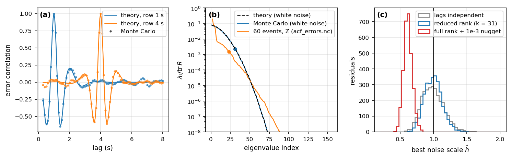

# Likelihood and Posterior

`complybay.inference` scores a seafloor model against data. These steps are
the whole method:

1. **Predict** every observation from the `OBSModel` the prior has built
   ([Parameterization](parameterization.md)). ACF observations with the same
   ray parameter, processing, `dt`, `duration` and `snr` (Z and P of one
   stack) share one seafloor response.
2. **Scale** the residuals by the stated standard deviations,
   $z_i = (d_i - g_i(\mathbf m))/s_i$, over the fitted samples (for an ACF,
   the lags inside its `window`).
3. **Independent groups** contribute a Gaussian with a sampled noise scale
   $h_k$ (§1).
4. **Correlated blocks** of ACF lags (and of Z with P) contribute a
   reduced-rank Gaussian (§3), with a correlation from the processing theory
   or from the event ACFs (§2).
5. **Sum** the terms: $\ln L$; the posterior adds the log prior (§4).

A solver exception or a non-finite prediction (for example a dispersion mode
without a root) gives $\ln L = -\infty$ with the reason. `JointLikelihood`
works on its own from Python with any `OBSModel`.

| class | data, sigma | x | settings (default) |
|---|---|---|---|
| `ComplianceObservation` | normalized compliance (1/Pa) | `freqs` (Hz) | `wavenumber` (`exact`) |
| `DispersionObservation` | phase velocity (km/s) | `periods` (s) | `wave` (`rayleigh`), `mode` (0), `algorithm` (`dunkin`), `dc` (0.005) |
| `ACFObservation` | stacked ACF on lags 0, `dt`, ..., `max_lag` | `ray_p` (s/km) | `component`, `processing`, `window` (s), `dt`, `duration`, `snr` |

`sigma` is a scalar or one value per sample. The forward solvers are on
[Compliance](compliance.md), [Dispersion](dispersion.md) and [ACF](acf.md).

## 1. Noise scales: why $N \ln h$, and the best $h$

Each group $k$ may name a sampled parameter holding $\log_{10} h_k$, which
scales its standard deviations:

--8<-- "docs/generated/likelihood_group.md"

The term $-N_k \ln h_k$ is the normalization of a Gaussian with standard
deviations $h_k s_i$ (constants that depend on neither the model nor $h_k$
are dropped). Without it a larger $h_k$ would always raise $\ln L$; with it
the scale settles where the residuals put it, so each group gets the weight
its misfit supports instead of a hand-tuned one. A uniform prior on
$\log_{10} h$ is uniform in $\ln h$; the workflow default, bounds
$[-0.5, 0.5]$ or $h \in [0.32, 3.2]$, is assumed. Without a noise parameter
$h = 1$. Noise-free synthetic data drive every $h$ to its lower bound.

A scale corrects the error level, not a correlation. Fitted with independent
lags, correlated ACF errors still give $\chi^2/N \approx 1$ and $h \approx 1$
(Fig. 1c, grey), but the ACF then counts as $N$ independent data instead of
the few it holds, and $\chi^2/N$ scatters three times wider than
$\chi^2_N/N$ would (sd 0.34 against 0.11 for 155 lags).

## 2. Where ACF errors are correlated

**The processing.** Whitening, filtering and normalization spread each raw
error over neighbouring lags. For additive noise that is white after
whitening, to first order (`processing_error_correlation`; derived here):

--8<-- "docs/generated/likelihood_theory.md"

$e_k$ are the independent errors of the raw autocorrelation of white noise
at lag $k$; the running-mean whitening over $W$ Hz multiplies them by
$1 - \operatorname{sinc}(W\tau)$; the filters convolve with $g$, the inverse
transform of their combined power response; $T$ is the zero-lag taper; and
normalization by the value at $\tau_0$ (0 for `zero_lag`, the expected peak
for `max`) subtracts $m(\tau)\,\varepsilon(\tau_0)$, $m$ the expected
normalized ACF. For `kim2023` it matches a Monte Carlo of the full processing
to 0.07 (largest of all lag pairs; 0.02 rms; Fig. 1a).

**The source.** Source wavelets that whitening does not flatten leave errors
that are correlated along the structure's own reverberations, and Z and P of
the same events share them. The theory does not describe these. From the
per-event ACFs, `stack_errors(event_acfs, dt, window, processing=...)` gives
the linear stack, its sigma $\mathrm{std}/\sqrt{n}$, and the sample
correlation inside the window, joint over components. With fewer events than
lags that matrix is singular, so it is shrunk towards a target $\mathbf T$
(the processing theory per component, zero between components; the identity
without `processing`):

--8<-- "docs/generated/likelihood_shrinkage.md"

The weight is the data-driven estimate of Schäfer & Strimmer (2005).
`complybay.io.write_acf_errors` stores the result (`acf_errors.nc`). How many
independent pieces of information an ACF over 0.3-8 s holds:

--8<-- "docs/generated/likelihood_numbers.md"

--8<-- "docs/generated/likelihood_neff.md"

The 60-event estimate is that of `examples/synthetic` (random 3 s source
wavelets, no additive noise; shrinkage weight 0.075; mean Z-P correlation
at equal lag 0.37): in this synthetic set the source-generated errors leave about a fifth of
the information the additive-noise theory assumes. Use the event estimate when per-event ACFs
exist; the theory is the fallback.

## 3. The reduced-rank block likelihood

A block holds the correlation $\mathbf R$ over the fitted samples of its
members, concatenated (`ErrorCorrelation(members, R, variance_fraction)`).
Only the $k$ leading eigenvectors are kept, $f$ = `variance_fraction`
(0.99, assumed):

--8<-- "docs/generated/likelihood_block.md"

With one member and $h$ this is the $k$-dimensional form of §1, with $k$ in
place of $N$.

**Why not the full rank.** These correlations are nearly singular: about half of
the eigenvalues lie below $10^{-8}$ of the trace (Fig. 1b). A residual of
the real processing is not exactly in the span the theory or an estimate
assigns to the smallest eigenvalues, so the full-rank $\chi^2$ is dominated
by them: $\chi^2/N \approx 10^5$ with the theory correlation on Monte Carlo
residuals. A diagonal nugget removes that, but then those directions carry
less residual than the nugget says, $\chi^2$ behaves like $\chi^2_k$ while
the $h$ term counts $N$, and $h$ is driven low (median 0.61 with a
$10^{-3}$ nugget; Fig. 1c, red). Keeping 99 % of the variance gives
$\chi^2/k$ = 1.01 on the same residuals (Fig. 1c, blue).



*Fig. 1. White noise through the full `kim2023` processing, 6000 traces of
70 s at 0.05 s (Monte Carlo), fitted window 0.3-8 s (155 lags). (a) Rows at
1 s and 4 s of the error correlation: theory (lines) and the first 3000
traces (dots). (b) Eigenvalues divided by the trace: theory (dashed),
Monte Carlo, and the Z block of the 60-event estimate of `examples/synthetic`;
dots: the 99 % cut. (c) Best noise scale $\hat h$ of each of the other 3000
traces with the theory correlation: lags independent ($\chi^2/N$), reduced
rank ($\lvert\mathbf y\rvert^2/k$), full rank with a $10^{-3}$ nugget
($\chi^2/N$); the true value is 1. Script:
`docs/scripts/likelihood_correlation.py`.*

## 4. The posterior target

`PosteriorTarget(prior, likelihood)` is the function a sampler explores:

$$
\ln p(\boldsymbol\theta \mid \mathbf d) = \ln p(\boldsymbol\theta) +
\ln L(\boldsymbol\theta) + \text{const}.
$$

$\boldsymbol\theta$ holds the model parameters and the $\log_{10} h$ noise
parameters; every noise parameter an observation names must be defined. The
prior is evaluated first: outside it the target is $-\infty$ without any
forward calculation. `prior_only=True` returns the log prior alone, for
sampling the model space before data enter. Besides the totals, the target
hands the sampler $\chi^2$ of each observation (stated sigma, $h = 1$) and
$\ln L$ of each term (independent groups, then blocks); they are stored with
the chains ([Sampling](sampling.md)).

## 5. Usage

```python
from complybay.acf import preset, processing_error_correlation
from complybay.inference import (
    ACFObservation, ComplianceObservation, ErrorCorrelation, JointLikelihood)
from complybay.io import read_three_columns

d = "examples/synthetic/"
c, z = read_three_columns(d + "compliance.dat"), read_three_columns(d + "acf_z.dat")
compliance = ComplianceObservation(c.x, c.value, c.sigma, noise_parameter="noise.compliance")
acf_z = ACFObservation("vertical", 0.06, preset("kim2023"), z.value, z.sigma, (0.3, 8.0))
R = processing_error_correlation(acf_z.processing, acf_z.lags[acf_z.mask], acf_z.dt,
                                 expected=acf_z.values)
likelihood = JointLikelihood((compliance, acf_z), (ErrorCorrelation((acf_z.name,), R),))
fit = likelihood.evaluate(obs_model, {"noise.compliance": 0.0})   # log10 h per named group
```

`obs_model` is any `OBSModel`, for example from
[Parameterization](parameterization.md#6-usage).

In `obs.yaml` for `complybay invert` (all keys, defaults and the
`error_correlation` forms: `complybay.workflow.config` in the API reference):

```yaml
Observations:
  compliance: {file: compliance.dat, noise: {bounds: [-0.5, 0.5]}}  # sampled log10 h
  acf:
    processing: kim2023
    ray_p: 0.06
    window: [0.3, 8.0]                       # s; start above the zero lag
    error_correlation: {file: acf_errors.nc} # none (default), processing, or a file
    components:
      vertical: {file: acf_z.dat, noise: true}
      pressure: {file: acf_p.dat, noise: true}
```

## Verified / not verified

Tests are in `tests/test_inference.py` and `tests/test_acf_errors.py`.

| claim | checked by |
|---|---|
| predictions equal the solvers; Z and P share one response | `test_predictions_match_the_forward_solvers`, `test_vertical_and_pressure_share_one_response` |
| $\ln L_k$ with $h$; best $h^2 = \chi^2/N$ | `test_noise_scale_term_and_its_optimum`; `docs/scripts/likelihood_formulas.py` |
| noise-free data fitted exactly at the truth | `test_noise_free_data_are_fitted_exactly_at_the_truth` |
| identity block = independent likelihood; full-rank block = scipy's multivariate normal (independent implementation) | `test_identity_correlation_gives_the_independent_likelihood`, `test_full_rank_block_matches_the_multivariate_normal`, `test_error_correlation_block_in_the_joint_likelihood` |
| reduced-rank block formula, shrinkage weight, theory formula against the package | `likelihood_formulas.py` only |
| processing theory against a Monte Carlo of the processing (`kim2023`, filters only) | `test_processing_correlation_matches_simulated_noise`; `likelihood_correlation.py` |
| reduced rank calibrated: $\chi^2/k \approx 1$ | `test_reduced_rank_block_is_calibrated_on_processing_errors` (residuals drawn from the theory); `likelihood_correlation.py` (residuals of the real processing) |
| shrinkage recovers a known correlation; stacks keep the Z-P correlation; file round trip | `test_shrinkage_recovers_a_known_correlation`, `test_stack_errors_keep_the_cross_component_correlation` |
| full rank drives $h$ low; effective-N table | `likelihood_correlation.py` only |
| prior failures skip the forward calculation; prior-only target; forward failure gives $-\infty$ | `test_prior_failures_skip_the_forward_calculation`, `test_prior_only_target_ignores_the_data`, `test_forward_failure_gives_minus_infinity_with_reason` |

All checks use synthetic data. Not checked: source-generated errors of real
stacks (only the synthetic events of `examples/synthetic`); the calibration of
$\chi^2/k$ for event-estimated correlations (no script in the repository
reproduces it); the choice $f$ = 0.99 beyond these cases; errors correlated
between data types or between ACF groups of different ray parameters
(taken as independent).

## References

- Kim, H., Kawakatsu, H., Akuhara, T., & Takeuchi, N. (2023). Characterizing
  the seafloor sediment layer using teleseismic body waves recorded by ocean
  bottom seismometers. *Journal of Geophysical Research: Solid Earth*,
  128(12), e2023JB027616 (the `kim2023` processing).
  [doi:10.1029/2023JB027616](https://doi.org/10.1029/2023JB027616)
- Schäfer, J., & Strimmer, K. (2005). A shrinkage approach to large-scale
  covariance matrix estimation and implications for functional genomics.
  *Statistical Applications in Genetics and Molecular Biology*, 4(1), 32.
  [doi:10.2202/1544-6115.1175](https://doi.org/10.2202/1544-6115.1175)
