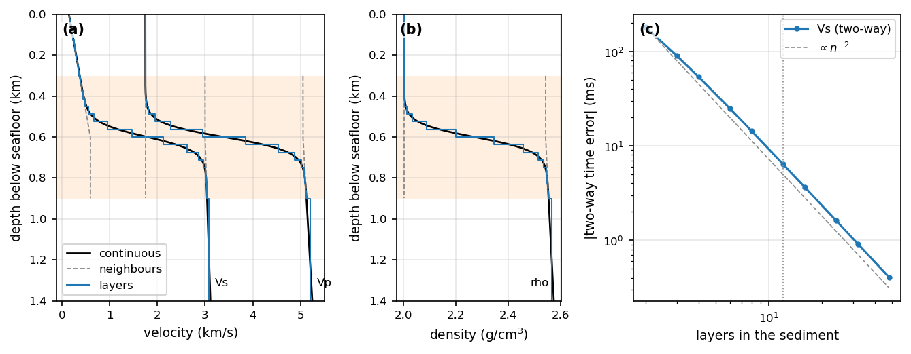
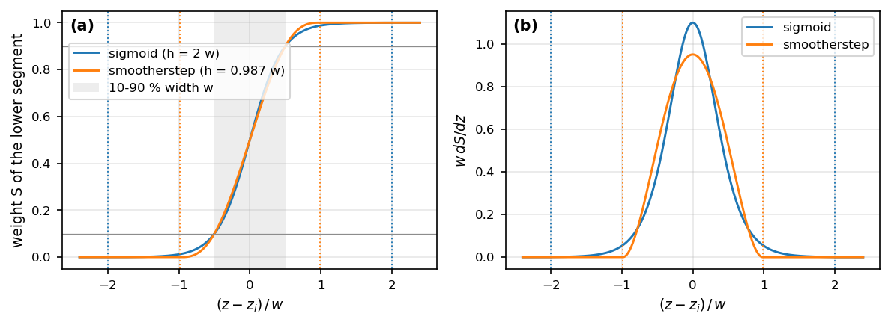

# Model Parameterization

A sampler moves a vector $\boldsymbol\theta$ of named scalars;
the forward solvers need homogeneous layers.
`complybay.parameterization` maps one to the other, independently of any
sampler. These steps are the whole method:

1. **Resolve.** Every `{parameter: name}` in the `Model` mapping takes its
   value from $\boldsymbol\theta$; literals stay fixed
   (`ModelParameterization.vector_to_model`).
2. **Continuous model** (`ParameterizedModel`). Interfaces at depths $z_i$
   split the column into segments. Each segment carries a $V_s$ profile on
   its own normalized depth, so it stretches when an interface moves (§2),
   takes $V_p$ from its own profile or from $V_s$, and $\rho$ from $V_p$ (§3).
   A gradational interface blends its two neighbours (§1).
3. **Layers** (`discretize`). Homogeneous layers over a half-space, a
   `LayeredModel` (§5).
4. **Water.** The fixed water column on top gives the `OBSModel` every solver
   takes.

`GeophysicalPrior` decides whether $\boldsymbol\theta$ is inside the prior
(§4). Depths are km below the seafloor. The mapping, the prior and the
layering are usable on their own from Python, without the sampler or the
`complybay invert` workflow.



*Fig. 1. The model space of `examples/synthetic` with the basement made
gradational: $\boldsymbol\theta$ = (basement depth 0.6 km, width 0.15 km,
sediment $V_s$ 0.15 → 0.6 km/s, sediment $V_p$ 1.75 km/s). (a) $V_s$ and $V_p$:
continuous model (black), each neighbour's own profile inside the transition
support (dashed; shaded), and the layers the solvers see (blue: 12 sediment
layers, 16 in the transition). (b) Density, same layout (Gardner in the
sediment, Brocher in the crust). (c) Error of the vertical two-way S time
through the sediment (hard basement) against the number of sediment layers,
against the closed form $2H\ln(b/t)/(b-t)$ of a linear $V_s$; it falls as
$n^{-2}$. Script: `docs/scripts/parameterization_example.py`.*

## 1. How two segments are joined

An interface has a depth $z_i$, a 10-90 % width $w$ (`width_km`, 0 = hard
step) and a `shape`. Every property is blended with one weight $S(z)$ that
rises from 0 to 1:

--8<-- "docs/generated/parameterization_blend.md"

$m_\mathrm{u}$ and $m_\mathrm{l}$ are the neighbours' own profiles, each
evaluated with depths clamped to its segment, so the upper one is held at its
bottom value below $z_i$ (Fig. 1a, dashed). $1/Q$ of an elastic neighbour is
0. The two shapes:

--8<-- "docs/generated/parameterization_transitions.md"

$S$ is exactly 0 above $z_i - h$ and exactly 1 below $z_i + h$. This compact
support keeps an interface from leaking into the seafloor or a neighbouring
interface: a support that reaches the seafloor, overlaps the previous one or
passes `zmax_km` raises `ValueError`, which the prior turns into
$\ln p = -\infty$ (§4). A `half_normal` prior on the width (§4) makes a hard
step the default that a gradational interface must improve on.



*Fig. 2. (a) Weight $S$ of the lower segment for both shapes against
$(z - z_i)/w$; shaded: the 10-90 % width; dotted: $\pm h$. (b) Slope
$w\,dS/dz$. Script: `docs/scripts/parameterization_transitions.py`; the
formulas are asserted against `transition_weight` in
`docs/scripts/parameterization_formulas.py`.*

## 2. Profiles within a segment

| `type` | keys | profile on the local coordinate $x \in [0, 1]$ |
|---|---|---|
| `constant` | `value` | $v$ |
| `gradient` | `top`, `bottom` | linear from `top` to `bottom` |
| `bspline` | `coefficients`, `degree` (3), `knot_spacing` (`geometric`), `knot_alpha` (2.0) | open-clamped B-spline |

--8<-- "docs/generated/parameterization_bspline.md"

The clamped knots make the first and last coefficients the values at the
segment top and bottom; interior coefficients are basis weights, not point
values. With geometric spacing the knot intervals grow by $\alpha$ downward,
so the profile is more flexible near the top; `uniform` (or $\alpha = 1$)
spaces them evenly. With fewer than $p + 1$ coefficients the degree drops to
$n - 1$. Coefficients must be positive.

## 3. Which quantity derives from which

$V_s$ is always a profile. $V_p$ comes from the first of: the segment's own
`vp` profile; a `vp_vs` profile times $V_s$; the segment's Vp relation applied
to $V_s$. Density always comes from the segment's density relation applied to
that $V_p$, so a sampled $V_p$ or $V_p/V_s$ also moves $\rho$. Relations are
set per segment under `scaling` (default: the model-level `scaling`, whose
default is `brocher2005` for both):

--8<-- "docs/generated/parameterization_scaling.md"

A relation outside its stated range raises `ValueError` (outside the prior);
a mantle segment needs a Vp relation that holds above $V_s$ = 4.5 km/s, such
as `constant_vp_vs`. The coefficients are those of the code; the citations
were checked (Crossref metadata), the coefficient values were not checked
against the papers' text.

**Why the sediment gets its own Vp.** Marine sediment $V_p$ stays near the
water velocity while $V_s$ grows several-fold with depth, so $V_p/V_s$ falls
from about 12 to 3 in the example. Relations of $V_s$ do not follow this in the example
sediment: Brocher's gives $V_p$ below the water velocity at the top, and a
constant $V_p/V_s$ that keeps the vertical P time does too
(table below; Castagna's mudrock line stays above it, but whether its
calibration data reach $V_s$ = 0.15 km/s was not checked). A sampled
constant `vp` (or a `gradient`) avoids the coupling. Its shape matters little:
a $V_p$ rising from 1.52 to 2.0 km/s with the same vertical P time
$t_{p2}$ as the constant 1.75 km/s changes compliance and 8-30 s phase
velocity far below their noise; only the ACF sees it, about as much as a 5 %
change of sediment thickness (example data and sigmas, noise-free; derived
here):

--8<-- "docs/generated/parameterization_sediment_vp.md"

*Script: `docs/scripts/parameterization_sediment_vp.py`.*

**Attenuation.** Optional `qp` and `qs` profiles make a segment attenuating
(constant Q, [Attenuation](attenuation.md)); fixed or sampled like any
profile. The velocities of an attenuating model are then those at
`Model.q_reference_frequency_hz` (default 1 Hz, assumed in
`complybay.model.layered`). $1/Q$ is blended like the velocities (§1); layers
take $Q$ at their midpoints, elastic layers $Q = \infty$.

## 4. The prior

$$
\ln p(\boldsymbol\theta) =
\begin{cases}
\sum_j \ln p_j(\theta_j) & \boldsymbol\theta \text{ inside the support}\\
-\infty & \text{otherwise}
\end{cases}
$$

Every parameter has hard bounds $[a, b]$; the type sets the (unnormalized)
density inside them:

--8<-- "docs/generated/parameterization_priors.md"

$\boldsymbol\theta$ is inside the support only if, in this order (the first
failure is returned as the reason):

| reason | fails when |
|---|---|
| `parameter_prior` | a parameter is outside its bounds |
| `model_mapping` | interfaces out of order; a transition support reaching the seafloor, a neighbour or `zmax_km`; a relation outside its range; a non-positive B-spline coefficient or $Q$; $V_p^2 \le \tfrac43 V_s^2$ (negative bulk modulus) in a layer |
| `physical_constraints: <names>` | a hard constraint below fails |

| `Constraints` `type` | keys (default) | fails when |
|---|---|---|
| `vp_vs_range` | `bounds` | $V_p/V_s$ outside `bounds` |
| `vs_range` | `bounds` | $V_s$ outside `bounds` |
| `monotonic_vs` | `tolerance` (0) | $V_s$ drops by more than `tolerance` between samples |
| `boundary_non_decreasing_vs` | `tolerance` (0) | $V_s$ drops across an interface (the two segments' own profiles at $z_i$) |
| `max_vs_gradient` | `max_abs` (km/s per km) | $\lvert dV_s/dz \rvert$ > `max_abs` |
| `vp_above_water` | `margin` (0) | $V_p$ < water $V_p$ + `margin` (passes without water) |

All but `boundary_non_decreasing_vs` take `segments` and `dz` (0.05 km, the
sampling of the check). With `segments`, a constraint checks those segments'
own profiles over their own intervals, which move with sampled interfaces and
ignore the blend inside a transition. Without it, it checks the whole blended
model, so `max_vs_gradient` then also bounds jump / width (about
$1.1\,\Delta V_s/w$ for a sigmoid, Fig. 2b).

`GeophysicalPrior.evaluate` never raises, returns the reason with
$-\infty$, and keeps the built `OBSModel` for the likelihood.
`sample_prior(prior, n, rng=...)` draws each parameter from its prior and
keeps the vectors inside the support: exact independent prior samples, with
the acceptance rate and the rejection reasons. A very low acceptance means
bounds and constraints contradict each other; the samples serve as diverse
chain starts ([Sampling](sampling.md)).

## 5. Layering and its travel-time error

`DiscretizationConfig` (defaults in brackets):

- a hard interface is always a layer boundary at its exact depth;
- each segment outside transition supports is split into
  `layers_per_segment` equal layers (a count, or a mapping by segment name;
  [none]) or else into layers of about `dz` km [0.5]. With sampled interface
  depths use counts: the geometry then moves continuously with
  $\boldsymbol\theta$, while `dz` changes the layer count in steps, which
  puts steps into the likelihood;
- each transition support gets `transition_layers` equal layers [16];
- a layer takes the properties at its midpoint, or their depth average with
  `layer_value: mean` [`midpoint`]; the half-space takes those at the model
  bottom, `zmax_km` (or `zmax`, if set and shallower).

`layering_report(model, layered)` compares the layers with the continuous
model; its key number is the relative error of the vertical travel time to
the half-space top,

--8<-- "docs/generated/parameterization_traveltime.md"

which bounds the timing error of vertical reverberations in the ACF. With the
midpoint rule it falls as $n^{-2}$ (Fig. 1c): 12 layers in the example
sediment put the two-way S time 6.4 ms (0.17 %) off; its constant $V_p$ is
layered exactly.

## 6. Usage

```python
from complybay.io import load_yaml
from complybay.parameterization import (
    DiscretizationConfig, GeophysicalPrior, constraints_from_config,
    parameterization_from_config, sample_prior)

cfg = load_yaml("examples/synthetic/model.yaml")
cfg["Model"]["water"] = {"depth_km": 2.0}              # fixed water column
p = parameterization_from_config(cfg)                  # uses Model and Inversion
layers = DiscretizationConfig(**cfg["Discretization"])
prior = GeophysicalPrior(p, layers, constraints_from_config(cfg["Constraints"]))
theta = sample_prior(prior, 4, rng=0).theta            # (4, 4): exact prior samples
obs_model = p.vector_to_obs_model(theta[0], layers)    # OBSModel for any solver
```

In `model.yaml` for `complybay invert` (runnable: `examples/synthetic/`; there
the water column comes from `obs.yaml`, `Station.water`):

```yaml
Model:
  zmax_km: 100.0                       # top of the half-space; required
  interfaces:                          # top to bottom
    - {name: basement, depth_km: {parameter: basement.depth},
       width_km: {parameter: basement.width}, shape: sigmoid}   # width 0, sigmoid by default
  segments:                            # one more than interfaces
    - name: sediment
      vs: {type: gradient, top: {parameter: sed.vs_top}, bottom: {parameter: sed.vs_bottom}}
      vp: {type: constant, value: {parameter: sed.vp}}         # or vp_vs: {...}
      scaling: {rho: {method: gardner1974}}
    - name: crust
      vs: {type: bspline, coefficients: [3.0, 3.4, 3.8]}     # Vp, rho: brocher2005
Inversion:
  parameters:
    - {name: basement.width, initial: 0.0,
       prior: {type: half_normal, scale: 0.05, bounds: [0.0, 0.2]}}
    - ...
Constraints:
  - {type: vs_range, bounds: [0.05, 1.5], segments: [sediment]}
  - {type: vp_above_water}
Discretization: {layers_per_segment: {sediment: 12, crust: 10}}
```

Every referenced parameter must be defined, and the initial values must give
a valid model; both are checked when the parameterization is built.

## Verified / not verified

Tests are in `tests/test_parameterization.py` unless named otherwise.

| claim | checked by |
|---|---|
| $S$ = 0.5 at $z_i$, 0.1 / 0.9 at $\mp w/2$, exactly 0 / 1 outside the support, monotone; equal to the hard model outside it; supports may not overlap | `test_transition_weight_is_a_compact_monotone_step`, `test_gradational_interface_blends_smoothly_and_matches_hard_outside`, `test_transition_supports_may_not_overlap_seafloor_neighbours_or_bottom` |
| the $S$ formulas, $h$, steepest slopes; the blend of $V_s$, $V_p$, $\rho$, $1/Q$; B-spline knots and profile against scipy; relation coefficients; prior densities | `docs/scripts/parameterization_formulas.py` only |
| density from the sampled $V_p$ or $V_p/V_s$; direct `vp` profile; Brocher range enforced; sampled $Q$ reaches the layers | `test_sampled_vp_vs_and_density_from_vp`, `test_direct_vp_profile_for_sediment`, `test_relation_errors_name_the_segment`, `test_sampled_sediment_q_reaches_the_layers` |
| hard interfaces are layer boundaries; transition layer count; counts keep the geometry continuous, `dz` does not | `test_hard_interfaces_are_exact_layer_boundaries`, `test_transition_support_gets_the_configured_layers`, `test_fixed_layer_counts_keep_geometry_continuous_in_interface_depth` |
| travel-time error converges; against an independent integral and the closed form | `test_layering_report_converges_and_detects_straddled_interfaces`; `parameterization_formulas.py`, `parameterization_example.py` |
| prior reasons; bulk-modulus check; segment constraints follow interfaces; prior samples valid and reproducible; contradictory prior fails | `tests/test_prior.py`: `test_invalid_vectors_get_minus_infinity_and_a_reason`, `test_negative_bulk_modulus_is_rejected_as_model_mapping`, `test_segment_constraints_follow_a_moving_interface`, `test_profile_constraints`, `test_prior_samples_are_valid_independent_and_reproducible`, `test_contradictory_prior_fails_loudly` |
| $\boldsymbol\theta$ → `OBSModel` runs every solver | `test_theta_to_obs_model_runs_every_forward_solver` |
| sediment-Vp numbers | `parameterization_sediment_vp.py` only; one synthetic model, noise-free |

Not checked: the relation coefficients against the papers' text, and the
ranges in which they hold for marine sediment; whether the prior bounds and
constraints suit real sites (they are choices of the user).

## References

- Brocher, T. M. (2005). Empirical relations between elastic wavespeeds and
  density in the Earth's crust. *Bulletin of the Seismological Society of
  America*, 95(6), 2081-2092.
  [doi:10.1785/0120050077](https://doi.org/10.1785/0120050077)
- Castagna, J. P., Batzle, M. L., & Eastwood, R. L. (1985). Relationships
  between compressional-wave and shear-wave velocities in clastic silicate
  rocks. *Geophysics*, 50(4), 571-581.
  [doi:10.1190/1.1441933](https://doi.org/10.1190/1.1441933)
- Gardner, G. H. F., Gardner, L. W., & Gregory, A. R. (1974). Formation
  velocity and density; the diagnostic basics for stratigraphic traps.
  *Geophysics*, 39(6), 770-780.
  [doi:10.1190/1.1440465](https://doi.org/10.1190/1.1440465)
- Perlin, K. (2002). Improving noise. *ACM Transactions on Graphics*, 21(3),
  681-682 (the smootherstep polynomial).
  [doi:10.1145/566654.566636](https://doi.org/10.1145/566654.566636)
