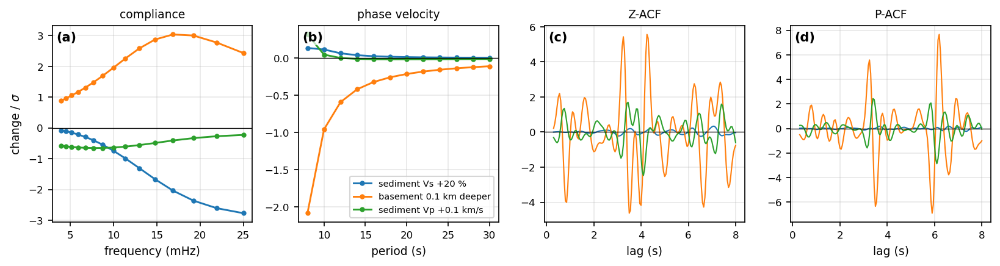

# What the Data Resolve

Everything on this page comes from synthetic inversions of one example
model family: `examples/synthetic` (2 km of water; a 0.6 km sediment with
$V_s$ rising linearly from 0.15 to 0.6 km/s and constant $V_p$ = 1.75 km/s
over a hard basement; fixed Brocher crust and mantle; 4 model parameters plus
4 noise scales) and its two-unit variant `examples/synthetic_layered`. Data:
compliance 4-25 mHz (10 %), Rayleigh phase velocity 8-30 s (0.02 km/s),
vertical (Z) and pressure (P) ACF with `kim2023` at $p$ = 0.06 s/km over
0.3-8 s (0.05 per lag), all made by `tools/make_synthetic_example.py` on a
finer layering. The posterior numbers below come from the `tools/` scripts
named with each table; **those inversions take 15-75 min and were not rerun
for this page**. Only Fig. 1 and its tables are recomputed here. Other
models, data and noise may behave differently.

## 1. What each data type sees

*Fig. 1. Change of each prediction, in units of its sigma, for three
perturbations of the true model of `examples/synthetic`: sediment $V_s$
+20 % (blue), basement 0.1 km deeper (orange), sediment $V_p$ +0.1 km/s
(green). (a) Compliance, (b) phase velocity, (c) Z-ACF and (d) P-ACF over the
fitted window. Forward calculations only. Script:
`docs/scripts/resolution_sensitivity.py`.*

$\chi^2 = \sum(\text{change}/\sigma)^2$ per group, the drop of $2\ln L$ at
$h = 1$ (last row: crust $V_s$ at its top +0.1 km/s in the two-unit model):

--8<-- "docs/generated/resolution_chi2.md"

Phase-velocity change in units of sigma at selected periods:

--8<-- "docs/generated/resolution_dispersion.md"

The ACF is dominated by sediment thickness and $V_p$, i.e. by the vertical P
two-way time $t_{p2}$, and barely sees $V_s$. Compliance is the only group
that sees sediment $V_s$. Phase velocity at 8-30 s (wavelengths 25-120 km)
sees how much crust the 0.6 km sediment replaces, hardly how soft it is.
Crust $V_s$ reaches the ACF through crustal $V_p$ (reverberations near 2 s)
carried by the Brocher relation, so that part holds only as far as the
relation does.

## 2. What each combination constrains

From `python tools/data_subset_test.py examples/synthetic runs/data_subsets`:
90 % interval width divided by the prior's (`*`: truth outside the interval).
$t_{s2}$: vertical S two-way time through the sediment; `vs_mean`:
travel-time average $V_s$; `vs_sqrt_mean`: $\big(\frac1H\int_0^H
\sqrt{V_s}\,dz\big)^2$ (definitions: `complybay.inference.ensemble`).

| data | basement | sed. $V_p$ | $t_{p2}$ | $t_{s2}$ | `vs_mean` | `vs_sqrt_mean` |
|---|---|---|---|---|---|---|
| compliance (C) | 0.50 | 0.79 | 0.28 | 0.21 | 0.37 | 0.56 |
| dispersion (D) | 0.20 | 0.94 | 0.22 | 0.32 | 0.87 | 0.84 |
| Z and P ACF | 0.03 | 0.11 | 0.01 | 0.53 | 1.08 | 1.03 |
| CD | 0.16 | 0.32 | 0.11 | 0.15 | 0.22 | 0.21 |
| CDZP | 0.03 | 0.10 | 0.01* | 0.14 | 0.21 | 0.08* |

- **The ACF fixes $t_{p2}$**, and through it basement depth and $V_p$ along a
  ridge basement / $V_p$ = $t_{p2}/2$ (posterior correlation +0.97). Z and P
  carry about the same information.
- **Compliance fixes the S two-way time and a mean $V_s$**, not the
  individual parameters.
- **Joint data resolve the sediment $V_s$ around a pivot**, not at its ends:
  with all four groups the end values are anti-correlated (-0.95), the
  gradient line rotating about a point 40-50 % down the sediment. Report
  `vs_sqrt_mean` (best fixed, ±6 %) or `vs_mid`, plus the sign of the
  gradient (P($V_s$ increases) = 0.97); not the end values.
- The misses marked `*` are the noise draw: over 20 noise realizations
  (`python tools/coverage_test.py examples/synthetic runs/coverage --seeds
  20`) the 90 % intervals held the truth 17-20 times per quantity (expected
  $18 \pm 1.3$). $t_{p2}$ came out late by 0.0020 s on average (standard error
  0.0007 s), 0.0006 s of it from the layering; its coverage (17/20) was the lowest.

**Two sediment units** (`examples/synthetic_layered`, `tools/data_subset_test.py
... --segments sed_upper sed_lower`): with the ACF, both interface depths
(0.22-0.26 and 0.77-0.82 km; truth 0.25, 0.80) and both $V_p$ are fixed; the
upper unit's mean $V_s$ to about ±10 %, the lower unit's only loosely, and
neither gradient. Without the ACF (CD) neither depth is resolved.

## 3. Correlated ACF errors

From `python tools/acf_correlation_test.py examples/synthetic
runs/acf_correlation`, with Z and P stacked from 60 synthetic events
(errors from the source wavelets only; [Likelihood](likelihood.md)): treating
lags as independent overstates what the ACF fixes. With correlated errors
the CDZP intervals widen by 1.8-3x for basement depth, 1.9-2.9x for $V_p$ and
1.4-2x for $t_{p2}$, and the truth falls outside 2 (`processing`) or 4
(`events`) of 9 quantities instead of 6. The stack of events also differs
from the forward ACF of the true model by about twice its sigma, so the ACF
noise scales rose to 1.4-2.3: keep them free on real data and read $h$ as the
size of the unmodelled part.

## 4. Multimodality and tempering

The ACF makes the posterior multimodal: another reverberation can line up
with the data. Fitting C, Z and P without dispersion, one of four chains
stayed in a mode with basement 0.25 km and $V_p$ at its bound (best log
posterior -537 against -157; R-hat 12.5). Leaving it needs basement and $V_p$
to move together, which one-parameter global jumps do not provide. With
parallel tempering (5 temperatures up to 30) all chains reached the same
mode (R-hat 1.001) at about 5 times the cost ([Sampling](sampling.md), §4).
Run untempered first and turn tempering on when R-hat or lagging chains point
to separate modes, or when the ACF is fitted without compliance. (Rerun of
the CZP case of `tools/data_subset_test.py` with `Sampler.tempering`; no
separate script.)

## 5. Attenuation

From `python tools/q_synthetic_test.py`: data made with sediment $Q_s$ = 20,
$Q_p$ = 100 (velocities at 1 Hz). Inverted with $Q$ fixed at the truth, the
result equals the elastic test within 1 %. Inverted elastically, the sediment
$V_s$ averages come out 6-7 % below their 1 Hz values: compliance carries the
$V_s$ information, so an elastic result is $V_s$ at compliance frequencies
(about 0.01 Hz), where the constant-Q velocity is 0.93-0.95 of that at 1 Hz
([Attenuation](attenuation.md)). Basement depth and $V_p$ moved by 1.4 %.
Whether the data constrain $Q$ themselves was not tested.

## Verified / not verified

| claim | source |
|---|---|
| Fig. 1 and the $\chi^2$ and dispersion tables (signs checked: thicker sediment raises compliance and lowers short-period velocity, stiffer sediment does the opposite) | `docs/scripts/resolution_sensitivity.py`, rerun |
| interval widths, correlations, pivot, coverage, two-unit model | `tools/data_subset_test.py`, `tools/coverage_test.py`; not rerun |
| correlated-error widening and noise scales | `tools/acf_correlation_test.py`; not rerun |
| multimodality and tempering | CZP case of `tools/data_subset_test.py` with tempering; not rerun, no script of its own |
| attenuation bias | `tools/q_synthetic_test.py`; not rerun |

Everything is synthetic: one family of models, the example's data sampling,
noise levels and (except §2 coverage) one noise realization. Not checked:
real data; other sediment thicknesses, water depths or data bands; whether
the noise model holds for real stacks.

## References

- Kim, H., Kawakatsu, H., Akuhara, T., & Takeuchi, N. (2023). Characterizing
  the seafloor sediment layer using teleseismic body waves recorded by ocean
  bottom seismometers. *Journal of Geophysical Research: Solid Earth*,
  128(12), e2023JB027616 (the `kim2023` processing).
  [doi:10.1029/2023JB027616](https://doi.org/10.1029/2023JB027616)
