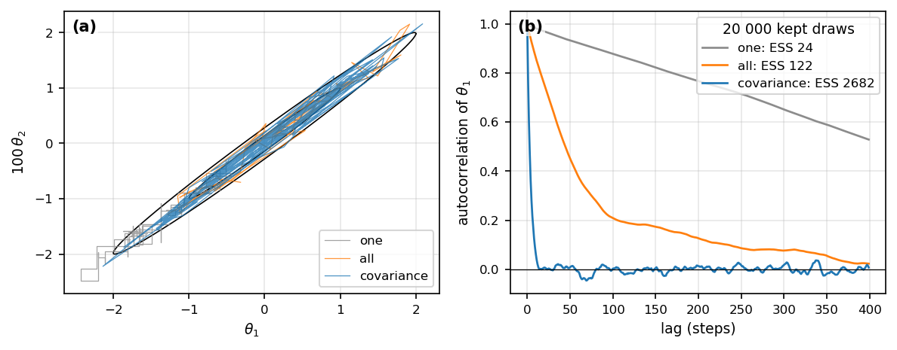
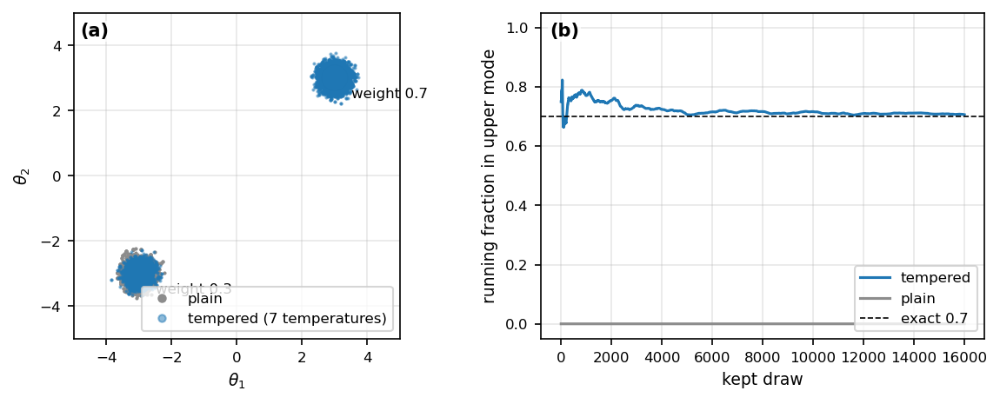

# Sampling

`complybay.inference.samplers` draws from a posterior target with
random-walk Metropolis (Metropolis et al. 1953; Hastings 1970). These steps
are the whole method, for each of several independent chains:

1. **Start** from a valid $\boldsymbol\theta$: an exact prior sample
   (`sample_prior`, [Parameterization](parameterization.md)) or the initial
   values.
2. **Propose** $\boldsymbol\theta'$ by a Gaussian step (§1); a proposal
   outside the parameter bounds is rejected without evaluating the target.
3. **Accept** with the Metropolis rule below; $T = 1$ samples the
   posterior (`temperature`, default 1).
4. **During burn-in only**, adapt the step (§2). Every
   `global_jump_interval` steps, propose a uniform jump instead (§3). With a
   ladder of temperatures, run replicas and swap their states (§4).
5. **Keep** every `thin`-th state after burn-in, and check the chains (§5).

--8<-- "docs/generated/sampling_metropolis.md"

A target is any object with `log_prior_and_likelihood(theta)` (the
`PosteriorTarget` of [Likelihood](likelihood.md)); `LogProbTarget` wraps a
plain log density, so the sampler works on its own from Python. Per-chain
seeds are spawned from one `seed`, so serial, thread and process runs give
identical samples. A parameter's step starts at its `proposal.sigma`, or 5 %
of its prior width.

## 1. Which update

| `update` | proposal | adapts | target acceptance |
|---|---|---|---|
| `one` | one randomly chosen parameter, $\theta_j' = \theta_j + \sigma_j \xi$ | each $\sigma_j$ on its own | 0.44 |
| `all` | every parameter, $\theta_j' = \theta_j + \sigma_j \xi_j$ | one common factor; the ratios of the $\sigma_j$ stay as given | 0.234 |
| `covariance` | `one` until `covariance_start` (default `burn_in // 2`), then all at once from a learned covariance (below) | $\sigma_j$, then $s$ and $\mathbf C$ | 0.44, then 0.234 |

The acceptance targets are the classical optimal-scaling values for one
dimension and for many (Gelman, Roberts & Gilks 1996; Roberts, Gelman &
Gilks 1997). `covariance` is adaptive Metropolis (Haario, Saksman &
Tamminen 2001) confined to burn-in:

--8<-- "docs/generated/sampling_am.md"

The diagonal floor (assumed) keeps the proposal positive definite for a
parameter that has not moved yet. On a trade-off ridge an axis-aligned step
must be as short as the ridge is narrow, so `one` and `all` crawl along it;
the covariance proposal steps along it (Fig. 1). Each chain learns its own
$\mathbf C$: a chain still in a wrong mode at the end of burn-in keeps a
covariance of that mode. Burn-in must be long enough for the one-parameter
phase to reach the main mode and for $\mathbf C$ to see the ridge.



*Fig. 1. A 2-D Gaussian with correlation 0.99 between parameters of
standard deviation 1 and 0.01 (the setup of `tests/test_samplers.py`);
30 000 steps, 10 000 of them burn-in with adaptation, from steps of
(0.5, 0.005). (a) The first 300 kept draws of each update over the 1- and
2-sigma ellipses. (b) Autocorrelation of $\theta_1$ and the effective sample
size of the 20 000 kept draws: 24 (`one`), 122 (`all`), 2682
(`covariance`). Script: `docs/scripts/sampling_updates.py`.*

## 2. Why adaptation stops at the end of burn-in

During burn-in the step follows a Robbins-Monro rule towards the target
acceptance (global-jump steps excluded):

--8<-- "docs/generated/sampling_adaptation.md"

At the end of burn-in every step size, $s$ and $\mathbf C$ are frozen. From
then on each step uses one fixed, symmetric proposal, so the stored states
form an ordinary time-homogeneous Metropolis chain whose stationary
distribution is the target; none of the conditions adaptive MCMC needs
(diminishing adaptation) arise. Burn-in states are not stored as draws, but
the trace (log posterior and per-group misfits every `thin` steps from step
0) keeps them for inspection.

## 3. Global jumps

Every `global_jump_interval` steps the proposal is uniform within the bounds:
one randomly chosen parameter (`one`, `covariance`) or the whole vector
(`all`, rarely accepted in more than a few dimensions). Its density does not
depend on the current state, so the acceptance rule above is unchanged, and
alternating fixed kernels that each leave the target invariant keeps the
chain valid. A jump moves a chain between modes that differ in one
parameter; it does not help when leaving a mode needs several parameters to
move together (Fig. 2, plain), as basement depth and sediment $V_p$ must in
the ACF ([Resolution](resolution.md)).

## 4. Parallel tempering

With `temperatures` $= (1, T_2, \dots, T_\mathrm{max})$ each chain becomes a
ladder of replicas stepped together in one process; replica $i$ samples
$p(\boldsymbol\theta)\, L(\boldsymbol\theta)^{1/T_i}$ with its own proposal
and adaptation. Every `swap_interval` steps adjacent replicas (even pairs and
odd pairs in turn) exchange states with (Geyer 1991; Earl & Deem 2005)

--8<-- "docs/generated/sampling_swap.md"

the Metropolis ratio of the product of the tempered targets, in which the
prior cancels. That product is invariant, so the $T = 1$ replica, the only
one stored, samples the posterior; the hot replicas cross between modes and
hand them down.

**Ladder.** `geometric_temperatures(n, T_max)` gives

--8<-- "docs/generated/sampling_ladder.md"

$T_\mathrm{max}$ must flatten the barrier: the hottest replica sees the drop
of $\ln L$ between modes divided by $T_\mathrm{max}$ (225 / 300 < 1 in
Fig. 2). The spacing must let neighbours swap: the acceptance per pair is
logged and stored; below about 0.1 a temperature is missing there (assumed
guideline, not enforced). The workflow default `tempering: {}` is 5
temperatures up to 30 (assumed). **Cost:** one target evaluation per replica
and step, so a ladder of $n$ costs $n$ plain runs. Run untempered first; turn
tempering on when R-hat or lagging chains (§5) point to separate modes.



*Fig. 2. Flat prior on $[-6, 6]^2$; modes of weight 0.3 at $(-3, -3)$ and 0.7
at $(3, 3)$, standard deviation 0.2 (the setup of `tests/test_samplers.py`).
Four chains start in the lower mode; `covariance` with a global jump every
20 steps, 20 000 steps, 4000 burn-in. (a) Kept draws of chain 0, plain (grey)
and with 7 geometric temperatures up to 300 (blue). (b) Running fraction of
the kept draws in the upper mode: the plain chains never leave the lower
mode; the tempered ones give 0.71 (exact: 0.7). Script:
`docs/scripts/sampling_tempering.py`.*

## 5. Diagnostics

Split R-hat (Gelman et al. 2013) compares the halves of all chains:

--8<-- "docs/generated/sampling_rhat.md"

The effective sample size (Vehtari et al. 2021, without rank normalization)
uses the multi-chain autocorrelation summed with Geyer's (1992) initial
monotone sequence:

--8<-- "docs/generated/sampling_ess.md"

A **lagging chain** is one whose log posterior lies wholly below that of the
best chain (highest median). In a converged run every chain samples the same
log-posterior distribution, so such a chain is stuck in a lower mode. R-hat
shows that a run has not converged, not which chain is at fault; chains that
mix slowly along a flat direction overlap in log posterior and are not
flagged. A flagged chain is reported and kept: deciding that its mode has no
mass needs tempering or more chains.

| quantity | where | criterion |
|---|---|---|
| split R-hat | `run.log`, `rhat` | > 1.1: warning (assumed threshold; 1.01-1.1 are common) |
| effective sample size | `run.log`, `ess` | no threshold in the code |
| lagging chain | `run.log` warning, attribute `lagging_chains` | 95th percentile of its log posterior below the best chain's 5th (assumed percentiles) |
| acceptance after burn-in | `run.log`, `acceptance_rate` | near 0.44 / 0.234 once adaptation has settled |
| swap acceptance | `run.log`, `swap_acceptance` | below about 0.1: add a temperature (assumed) |

The per-group $\chi^2$ stored with the draws and the trace
(`group_chi2`, `trace_group_chi2`) show which data move: the total
$\ln L$ mostly follows the group whose misfit changes most.

## 6. Usage

```bash
cd examples/synthetic
complybay invert --model model.yaml --obs obs.yaml -o run_posterior
complybay invert --model model.yaml -o run_prior --prior-only       # no data needed
complybay invert --model model.yaml --obs obs.yaml -o run_both --with-prior
```

`model.yaml` holds the model space and how it is sampled (`Model`,
`Inversion`, `Constraints`, `Discretization`, `Sampler`, `Output`); `obs.yaml`
holds one station, its data files and forward settings (`Station`,
`Observations`, `Forward`), so one model space serves stations at different
water depths. The sampler keys discussed here, with their defaults:

```yaml
Sampler:
  n_steps: 20000            # per chain
  burn_in: 5000             # adaptation only here; not stored
  thin: 10
  n_chains: 4
  update: one               # one | all | covariance
  adapt: true
  covariance_start: null    # covariance only; null: burn_in // 2
  global_jump_interval: 20  # null: none
  tempering: null           # {}: 5 temperatures to 30; or {temperatures: [1, 3, 9]}; swap_interval: 1
  executor: process         # serial | thread | process
  seed: null
  initial: prior            # prior: exact prior samples; theta0: the initial values
```

Other options: `--overwrite`, `--progress` / `--progress-every N` (not with
the process executor), `--log-level`. Output files and variables are listed
in the API reference (`complybay.workflow.driver`, `complybay.io.netcdf`).
From Python, `run_metropolis(target, starts, MetropolisConfig(...), seed=...,
executor=...)`; note that `MetropolisConfig` defaults to no burn-in, no
thinning, no adaptation and no global jumps.

## Verified / not verified

Tests are in `tests/test_samplers.py` unless named otherwise.

| claim | checked by |
|---|---|
| recovers a Gaussian from badly scaled steps, hits 0.44 / 0.234 | `test_recovers_a_gaussian_from_badly_scaled_proposals` |
| $T$ flattens only the likelihood | `test_temperature_flattens_only_the_likelihood`; `docs/scripts/sampling_formulas.py` (exact stationary mass) |
| Robbins-Monro rule; adaptive-Metropolis covariance and scale | `sampling_formulas.py` only (adapted values reproduced from the recorded states) |
| covariance proposal learns the ridge, mixes faster, is frozen and reproducible | `test_covariance_proposal_learns_a_correlated_ridge`, `test_covariance_proposal_mixes_faster_than_one_parameter_updates`, `test_covariance_proposal_is_frozen_after_burn_in_and_reproducible`; ESS numbers in `sampling_updates.py` only |
| global jumps cross between modes separated in one parameter | `test_global_jumps_cross_between_separated_modes` |
| tempering recovers mode weights 0.3 / 0.7; swap rule; ladder | `test_parallel_tempering_recovers_the_mode_weights`, `test_tempering_configuration`; `sampling_formulas.py` |
| lagging chains flagged | `test_lagging_chains_flags_a_chain_stuck_in_a_lower_mode` |
| R-hat and ESS on known processes; against independent sums | `tests/test_workflow.py::test_rhat_and_ess_on_known_processes`; `sampling_formulas.py` |
| bounds, burn-in, thinning, reproducibility, executors | `test_samples_stay_inside_bounds`, `test_burn_in_thin_and_reproducibility`, `test_executors_give_the_serial_result` |
| details travel with the states through swaps | `test_details_follow_the_stored_states` |

All checks use toy targets with known answers. Not checked: that the
default ladder, burn-in or chain length suffice for a given real data set;
the swap-acceptance guideline of 0.1.

## References

- Earl, D. J., & Deem, M. W. (2005). Parallel tempering: theory,
  applications, and new perspectives. *Physical Chemistry Chemical Physics*,
  7(23), 3910-3916. [doi:10.1039/B509983H](https://doi.org/10.1039/B509983H)
- Gelman, A., Carlin, J. B., Stern, H. S., Dunson, D. B., Vehtari, A., &
  Rubin, D. B. (2013). *Bayesian Data Analysis* (3rd ed.). CRC Press.
  [doi:10.1201/b16018](https://doi.org/10.1201/b16018)
- Gelman, A., Roberts, G. O., & Gilks, W. R. (1996). Efficient Metropolis
  jumping rules. In *Bayesian Statistics 5*, 599-607. Oxford University
  Press (no DOI; not checked).
- Geyer, C. J. (1991). Markov chain Monte Carlo maximum likelihood. In
  *Computing Science and Statistics: Proceedings of the 23rd Symposium on the
  Interface*, 156-163 (no DOI; not checked).
- Geyer, C. J. (1992). Practical Markov chain Monte Carlo. *Statistical
  Science*, 7(4), 473-483.
  [doi:10.1214/ss/1177011137](https://doi.org/10.1214/ss/1177011137)
- Haario, H., Saksman, E., & Tamminen, J. (2001). An adaptive Metropolis
  algorithm. *Bernoulli*, 7(2), 223-242.
  [doi:10.2307/3318737](https://doi.org/10.2307/3318737)
- Hastings, W. K. (1970). Monte Carlo sampling methods using Markov chains and
  their applications. *Biometrika*, 57(1), 97-109.
  [doi:10.1093/biomet/57.1.97](https://doi.org/10.1093/biomet/57.1.97)
- Metropolis, N., Rosenbluth, A. W., Rosenbluth, M. N., Teller, A. H., &
  Teller, E. (1953). Equation of state calculations by fast computing
  machines. *Journal of Chemical Physics*, 21(6), 1087-1092.
  [doi:10.1063/1.1699114](https://doi.org/10.1063/1.1699114)
- Roberts, G. O., Gelman, A., & Gilks, W. R. (1997). Weak convergence and
  optimal scaling of random walk Metropolis algorithms. *Annals of Applied
  Probability*, 7(1), 110-120.
  [doi:10.1214/aoap/1034625254](https://doi.org/10.1214/aoap/1034625254)
- Vehtari, A., Gelman, A., Simpson, D., Carpenter, B., & Bürkner, P.-C.
  (2021). Rank-normalization, folding, and localization: an improved
  $\hat R$ for assessing convergence of MCMC. *Bayesian Analysis*, 16(2),
  667-718. [doi:10.1214/20-BA1221](https://doi.org/10.1214/20-BA1221)
